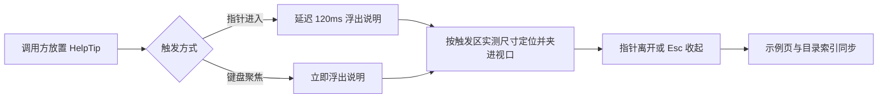
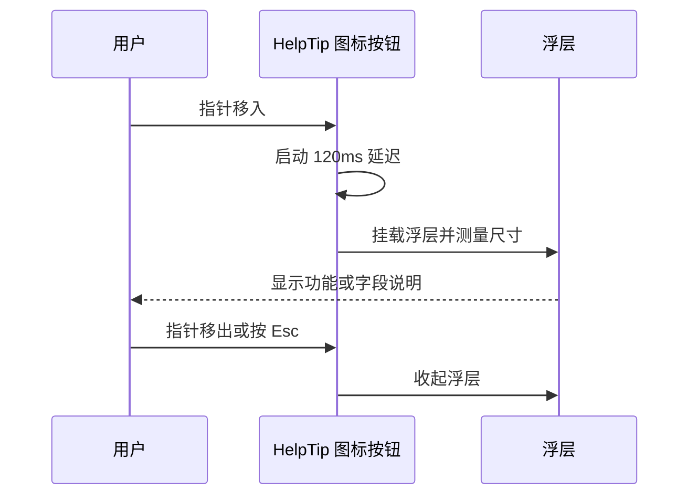

# 图标式气泡帮助组件（HelpTip）

结论：组件库缺少「图标 + 悬停气泡说明」这一形态，本次新增 `HelpTip` 组件补齐。影响：字段标签、业务术语、配置项旁可以直接放一个问号或信息图标，指针移上去或键盘聚焦时浮出说明，不必再用一行常驻文字占位。范围：新增一个本地扩展组件，同步分类归属、示例变体、组件目录索引与文档计数。非范围：不改冻结的上游组件与七层样式，不新增设计令牌，不改造既有 Tooltip 与 HoverCard。变化：组件总数从 151 增至 152，`display/tooltip` 子分组从 1 个组件变为 2 个。完成标准：分类、示例、覆盖率、冻结、污染五道守卫全部通过，类型检查、单测与构建通过，真实浏览器实测悬停、聚焦与 Esc 三种交互。术语说明：图标式帮助指以一个小图标作为触发入口、以浮层承载说明文字的提示形态；气泡指浮在页面上方、不挤压布局的说明层。验证状态：本文件为已确认需求，实施结果以测试主文档与 6-review 记录为准。

## 1. 文档信息

- 需求标题：图标式气泡帮助组件（HelpTip）
- 版本与状态：v1.0 / 已确认
- 需求来源：用户指出组件库缺少「有一个图标，鼠标移动到这个位置就弹出悬浮说明」的组件，并附橙色问号圆环与蓝色信息圆环两张参考图。
- 修订记录：
  - v1.0 / 2026-10-17 / 首次落盘 / 当前会话
- 来源对象标识：`REQ-PEARL-HELP-TIP-001`
- 复杂度等级：L2
- 当前优先闭环：单周期完成组件实现、分类与示例接入、守卫与真实浏览器验证。

## 2. 当前计划最终方案简要说明

推荐方案：在本地扩展层 `src/components/extend/` 新增 `HelpTip.vue`，组件自带图标按钮与浮层，图标路径在组件内内联，浮层定位与动效复用既有的 `overlayEnter/overlayLeave` 与 `floatingLayerFor`，材质复用全局 `.m-float`，颜色只引用 `tokens.css` 令牌。选择这条路线的原因：上游 139 个文件逐字节冻结，图标表 `src/data/icons.ts` 与七层样式都在冻结面内，新增问号图标与橙色令牌都必须改动冻结文件，只有「本地扩展层 + 组件内样式 + 现有令牌」能在不触碰冻结层的前提下补齐能力。

## 3. Agent 对当前问题的理解

- 问题 / 目标：组件库已有 `Tooltip`（纯文字气泡，触发区由调用方提供）、`HoverCard`（富内容名片）、`IconButton`（只有浏览器原生 `title`），没有任何组件把「小图标」与「悬浮说明」封装成一个可直接放进字段标签或业务术语旁的成品。
- 本轮范围：新增 `HelpTip.vue`；把组件登记进 `display/tooltip` 子分组；补示例样本与至少三组示例变体；重生成组件目录索引；同步 `SKILL.md`、`LOCAL-GUIDE.md` 的组件计数；落盘需求、测试主文档与 6-review。
- 非范围：不改上游 `Tooltip.vue`、`HoverCard.vue`、`IconButton.vue`、`src/data/icons.ts`、七层样式与 `main.ts`；不新增设计令牌；不做 Git 提交。
- 当前优先闭环：组件可用、可键盘操作、可在示例页看到、五道守卫全绿。
- 关键假设 / 待确认点：参考图的橙色问号是通用惯例示意，本项目语义色板只有蓝、青柠、红三色，且令牌文件冻结，因此问号态使用中性墨色、信息态使用主蓝色；若后续产品要求橙色，需单独立项扩展令牌。
- `unresolved_decisions`：无。

### 3.1 决策冻结

| `DEC-*` | 决策问题 | 候选方案 | 选定方案 | 排除原因 | 影响面 | 回滚 |
| --- | --- | --- | --- | --- | --- | --- |
| `DEC-HELP-001` | 组件落点 | A 上游 `extend/` 目录内新增 / B 新建独立目录 / C 改 `ui/` 既有组件 | A 本地扩展层 `src/components/extend/HelpTip.vue` | `ui/` 目录文件全部冻结，改动即 `FIDELITY` 失败；新建独立目录会引入第四种物理归属，与现有七层目录契约冲突 | `component-library/src/components/extend/HelpTip.vue` | `ROLLBACK-HELP-001`：删除该文件并还原分类与示例登记 |
| `DEC-HELP-002` | 问号图标来源 | A 在冻结的 `src/data/icons.ts` 新增问号 / B 组件内内联 SVG 路径 | B 组件内内联 SVG 路径 | 图标表属上游冻结面，缝隙机制只允许「新增声明行后逐字节相等」，容不下新增图标常量 | `HelpTip.vue` 的模板与样式 | 同 `ROLLBACK-HELP-001` |
| `DEC-HELP-003` | 配色口径 | A 新增橙色令牌 / B 复用现有语义色 | B 问号态用 `--ink-muted`、信息态用 `--blue` | `tokens.css` 冻结，新增令牌必须改冻结文件；珍珠玻璃语义色板本就没有橙色，硬编码色值违反本地扩展层只引用令牌的约束 | `HelpTip.vue` 的 `<style scoped>` | 同 `ROLLBACK-HELP-001` |
| `DEC-HELP-004` | 分类归属 | A 新增 `helptip` 子分组 / B 并入现有 `display/tooltip` | B 并入 `display/tooltip` | 两者同属「悬停说明」单一概念，新增子分组会让菜单为一个组件单独加一页，与「单一概念分组」不冲突但收益为零 | `component-categories.data.ts` | 同 `ROLLBACK-HELP-001` |

### 3.2 普通模型零决策执行契约

- 本文档只定义「做什么」与「做到什么算完成」，不定义低层实现细节。
- 普通模型执行时不得自行补充范围、默认值、异常、权限、兼容、文件落点、测试断言或回滚边界；任何缺失项必须写 `N/A + 原因 + 证据` 并回流需求域。
- 每个 `REQ-*` / `RULE-*` 必须能回指至少一个 `AC-*`，每个 `AC-*` 必须能回指测试记录或阻断原因。
- 需求文档未落盘或机器校验失败时，不得进入实施与编码。

### 3.3 垂直切片与追踪契约

- 垂直切片唯一归属：`SLICE-HELP-01` 只归属图标式气泡帮助组件，不与其他来源对象重复归属。
- 追踪契约：`SRC-* -> DEC-* -> REQ/RULE-* -> AC-* -> CYCLE-* -> TASK-* -> TEST-* -> EVIDENCE-*` 双向可追踪，详见第 13 章追踪矩阵。
- `unresolved_decisions`：无；四个决策点均按推荐方案冻结。

## 4. 需求来源与证据台账

| 来源 ID | 来源类型 | 原文摘录 / 事实 | 证据路径 | 责任人 |
| --- | --- | --- | --- | --- |
| `SRC-HELP-001` | 用户会话 | 「我们是不是少一个汽包帮助的组件，类似于我们的截图，就是有一个图标，鼠标移动到这个位置就弹出悬浮说明一下这个功能/字段/业务 是个什么的」 | 当前会话 | 用户 |
| `SRC-HELP-002` | 用户截图 | 橙色问号圆环与蓝色信息圆环两张图标参考图 | 当前会话附件 | 用户 |
| `SRC-HELP-003` | 本地代码 | `extend/Tooltip.vue` 只有 `content` 文字与默认插槽触发区，不自带图标 | `component-library/src/components/extend/Tooltip.vue` | 本地 |
| `SRC-HELP-004` | 本地代码 | `ui/HoverCard.vue` 是 `card` 插槽承载的富内容名片，不是单句说明 | `component-library/src/components/ui/HoverCard.vue` | 本地 |
| `SRC-HELP-005` | 本地代码 | `ui/IconButton.vue` 只设置原生 `title`，无自定义浮层与键盘说明语义 | `component-library/src/components/ui/IconButton.vue` | 本地 |

## 5. 目标与非目标

| ID | 目标 | 验收回指 |
| --- | --- | --- |
| `REQ-HELP-001` | 新增 `HelpTip` 组件：小图标按钮 + 悬停浮层说明，浮层自动避让视口四边 | `AC-HELP-001`、`AC-HELP-006` |
| `REQ-HELP-002` | 键盘与读屏可用：聚焦显示、Esc 关闭、`aria-describedby` 关联说明、按钮有可读名称 | `AC-HELP-006` |
| `REQ-HELP-003` | 组件登记进 `display/tooltip` 子分组，示例页提供至少三组可辨识变体 | `AC-HELP-002`、`AC-HELP-003` |
| `REQ-HELP-004` | 组件目录索引、`SKILL.md` 与 `LOCAL-GUIDE.md` 的组件计数同步为 152 | `AC-HELP-004` |
| `BOUND-HELP-001` | 非范围：不改冻结文件、不新增令牌、不改既有提示组件、不做 Git 提交 | `AC-HELP-005` |

## 6. 角色、权限与责任

| ID | 角色 | 责任 | 权限边界 |
| --- | --- | --- | --- |
| `REQ-HELP-010` | 用户 | 提出缺口、提供视觉参考、确认方案 | 有权变更范围或终止 |
| `REQ-HELP-011` | 主 agent | 落盘需求、实现组件、接入分类与示例、跑守卫与真实浏览器验证、收口 6-review | 不得在需求未落盘前进入编码 |
| `REQ-HELP-012` | artifact gate | 校验需求、测试与 6-review 文档 | 校验失败必须回流，不得口头放行 |

## 7. 功能需求

| ID | 需求陈述 | 触发条件 / 输入 | 处理规则 | 输出 / 结果 | 异常与边界 | 验收回指 |
| --- | --- | --- | --- | --- | --- | --- |
| `REQ-HELP-001` | 图标式帮助入口 | 调用方在字段标签或术语旁放置组件 | 渲染一个无背景的图标按钮；指针进入后延迟 120ms 浮出说明；指针离开收起；浮层按触发区实测尺寸定位，超出视口时翻到对侧并夹在四边 8px 内 | 图标按钮与 `.m-float` 浮层 | `content` 为空时不浮出；`disabled` 时按钮不可聚焦 | `AC-HELP-001`、`AC-HELP-006` |
| `REQ-HELP-002` | 键盘与读屏 | 用户用 Tab 聚焦图标或按 Esc | 聚焦立即浮出；Esc 收起；按钮 `aria-label` 取 `label`；浮层 `role="tooltip"` 并由 `aria-describedby` 关联 | 可键盘操作的帮助入口 | 无 | `AC-HELP-006` |
| `REQ-HELP-003` | 分类与示例接入 | 新增组件落盘后 | 归入 `display/tooltip`；示例页给出 tone、placement、size 等可辨识变体，至少三组 | 分类真相源与示例变体 | 变体渲染指纹不得与基础格相同 | `AC-HELP-002`、`AC-HELP-003` |
| `REQ-HELP-004` | 索引与计数同步 | 组件落盘后 | 重生成组件目录索引；同步 `SKILL.md`、`LOCAL-GUIDE.md` 的组件总数与示例总数 | 索引与文档一致 | 计数与实际不符即判失败 | `AC-HELP-004` |

## 8. 业务规则与优先级

| ID | 规则 | 优先级 | 默认值 / 例外 | 关联需求 |
| --- | --- | --- | --- | --- |
| `RULE-HELP-001` | 组件样式只引用 `tokens.css` 的 CSS 变量，禁止硬编码色值 | P0 | 无 | `REQ-HELP-001` |
| `RULE-HELP-002` | 不得修改上游冻结文件；图标与样式全部落在组件自身 | P0 | 无 | `REQ-HELP-001`、`REQ-HELP-004` |
| `RULE-HELP-003` | 组件单文件不超过 200 行，单函数不超过 80 行 | P0 | 无 | `REQ-HELP-001` |
| `RULE-HELP-004` | 浮层必须同时支持指针与键盘两种触发，不得只做 hover | P0 | 无 | `REQ-HELP-002` |
| `RULE-HELP-005` | 示例变体之间必须有可辨识差异，不得用同值 props 凑数 | P1 | 无 | `REQ-HELP-003` |

## 9. 数据与外部契约

- 数据来源：本仓库组件库源码、设计令牌文件、分类真相源、示例装配层。
- 外部项目代码引用：`N/A + 原因 + 证据`。原因：本需求只改本仓库组件库，不复制或引用任何外部项目代码。证据：`SRC-HELP-001` 至 `SRC-HELP-005` 均为本仓库与用户会话来源。
- 兼容性：新增组件不改任何既有组件契约；`display/tooltip` 子分组的组件数组由 1 项变为 2 项，路由键不变，既有页面地址不受影响。

## 10. 状态、流程与时序

图形目的与关联 ID：此图为组件的两种触发路径与收口路径，关联 `REQ-HELP-001`、`REQ-HELP-002`、`REQ-HELP-003`、`REQ-HELP-004`。

图形目的与关联 ID：此图为一次悬停取证的时序，关联 `REQ-HELP-001`、`AC-HELP-006`。

### 10.1 图片资产决策

- 图片资产决策：`N/A + 原因 + 证据`。原因：组件使用内联矢量图标，不引入位图资产，也不需要截图基线。证据：`DEC-HELP-002` 选定组件内内联 SVG 路径，第 10 章已含流程图与时序图。

## 11. 非功能与运营约束

- 可维护性：图标路径与样式集中在单一组件文件，分类与示例由既有守卫自动对账。
- 可观测性：守卫输出组件总数、示例组数与覆盖率，真实浏览器验证输出浮层可见性与键盘交互结果。
- 安全与合规：组件不引入外部依赖、不发网络请求、不读取用户数据。
- 回滚：`ROLLBACK-HELP-001` 删除组件文件并还原分类与示例登记；未提交前可逐个文件还原。

## 12. 风险、假设、依赖与阻断

| ID | 风险 / 阻断 | 触发证据 | 缓解 / 恢复 |
| --- | --- | --- | --- |
| `GAP-HELP-001` | 新增组件后分类守卫报未归类 | `CATEGORIES: FAIL` 点名 `HelpTip` | 在 `component-categories.data.ts` 的 `tooltip` 子分组补登记后重跑 |
| `GAP-HELP-002` | 示例变体不足三组 | `DEMO_VARIANTS: FAIL` 点名组数 | 补策展变体或调整派生值域后重跑 |
| `GAP-HELP-003` | 浮层在示例卡片内被裁切 | 真实浏览器中浮层不可见 | 浮层经 `Teleport` 挂到 `body` 并 `position: fixed`，不受卡片滚动容器裁切 |
| `GAP-HELP-004` | 冻结守卫报漂移 | `FIDELITY: FAIL` 点名文件 | 只允许新增本地文件与本地分类数据，冻结文件保持零改动 |

## 13. 追踪矩阵

| 来源 / 完成条件 | 决策 | 需求 / 规则 | 周期 | 任务 | 文件 / 符号 | 测试 | 证据 | 状态 |
| --- | --- | --- | --- | --- | --- | --- | --- | --- |
| `SRC-HELP-001`/`AC-HELP-001` | `DEC-HELP-001`、`DEC-HELP-002`、`DEC-HELP-003` | `REQ-HELP-001`、`RULE-HELP-001`、`RULE-HELP-002`、`RULE-HELP-003` | `CYCLE-HELP-01` | `TASK-HELP-01` | `src/components/extend/HelpTip.vue` | `TEST-HELP-01` | `EVIDENCE-HELP-01` | 待实施 |
| `SRC-HELP-001`/`AC-HELP-006` | `DEC-HELP-001` | `REQ-HELP-002`、`RULE-HELP-004` | `CYCLE-HELP-01` | `TASK-HELP-02` | `HelpTip.vue` 的键盘与 ARIA 分支 | `TEST-HELP-02` | `EVIDENCE-HELP-02` | 待实施 |
| `SRC-HELP-003`/`AC-HELP-002` | `DEC-HELP-004` | `REQ-HELP-003`、`RULE-HELP-005` | `CYCLE-HELP-01` | `TASK-HELP-03` | `component-categories.data.ts`、`demo-props.ts`、`demo-variants.generated.ts` | `TEST-HELP-03` | `EVIDENCE-HELP-03` | 待实施 |
| `SRC-HELP-004`/`AC-HELP-004` | `DEC-HELP-001` | `REQ-HELP-004` | `CYCLE-HELP-01` | `TASK-HELP-04` | `references/component-catalog.json`、`SKILL.md`、`LOCAL-GUIDE.md` | `TEST-HELP-04` | `EVIDENCE-HELP-04` | 待实施 |
| `BOUND-HELP-001`/`AC-HELP-005` | `DEC-HELP-002`、`DEC-HELP-003` | 非范围声明 | `CYCLE-HELP-01` | `TASK-HELP-05` | 冻结面与守卫结果 | `TEST-HELP-05` | `EVIDENCE-HELP-05` | 待实施 |

`AC-*` 完成条件冻结：`AC-HELP-001` 组件在示例页可挂载且浮层可见；`AC-HELP-002` `CATEGORIES` 报 152 组件且无未归类；`AC-HELP-003` `DEMO_VARIANTS` 报 `HelpTip` 至少 3 组；`AC-HELP-004` 目录索引与两处计数同步为 152；`AC-HELP-005` `FIDELITY` 与 `POLLUTION` 全绿；`AC-HELP-006` 浏览器实测悬停、聚焦、Esc 三条路径；`AC-HELP-007` 6-review 输出 `STYLE: PASS`。

## 执行附录

- 执行顺序：需求落盘 → 组件实现 → 分类与示例接入 → 索引与计数同步 → 五道守卫 → 类型检查与构建 → 真实浏览器实测 → 测试主文档 → 6-review → 项目记忆与临时产物清理。
- 关键命令：
  - 分类守卫：`node frontend-design/scripts/check_component_categories.mjs`
  - 示例守卫：`node frontend-design/scripts/check_demo_variants.mjs`
  - 覆盖率守卫：`node frontend-design/scripts/check_admin_component_coverage.mjs`
  - 冻结守卫：`python frontend-design/scripts/verify_fidelity.py --offline`
  - 污染扫描：`python test-strategy-rules/scripts/scan_test_pollution.py --root . --diff-only`
  - 索引生成：`node frontend-design/scripts/build_component_catalog.mjs`
  - 变体生成：`node frontend-design/scripts/build_demo_variants.mjs`
  - 类型检查：`cd frontend-design/component-library && npx vue-tsc --noEmit`
  - 单测与构建：`cd frontend-design/component-library && npm run test:unit && npx vite build`
- 清理与回滚：删除 `HelpTip.vue` 并还原分类与示例登记即回滚（`ROLLBACK-HELP-001`）；临时截图与脚本在收口前删除。

## 追踪附录

- 稳定 ID 清单：`REQ-PEARL-HELP-TIP-001`、`SRC-HELP-001..005`、`DEC-HELP-001..004`、`REQ-HELP-001..004`、`RULE-HELP-001..005`、`BOUND-HELP-001`、`AC-HELP-001..007`、`SLICE-HELP-01`、`GAP-HELP-001..004`、`ROLLBACK-HELP-001`、`CYCLE-HELP-01`、`TASK-HELP-01..05`、`TEST-HELP-01..05`、`EVIDENCE-HELP-01..05`。
- 机器可读定位：`component-library/src/components/extend/HelpTip.vue`（组件）、`component-library/src/data/component-categories.data.ts`（分类）、`component-library/src/views/gallery/demo-props.ts`（示例样本）、`references/component-catalog.json`（目录索引）。
- 附录维护规则：执行附录与追踪附录连续位于文档末尾，其后无业务正文。
