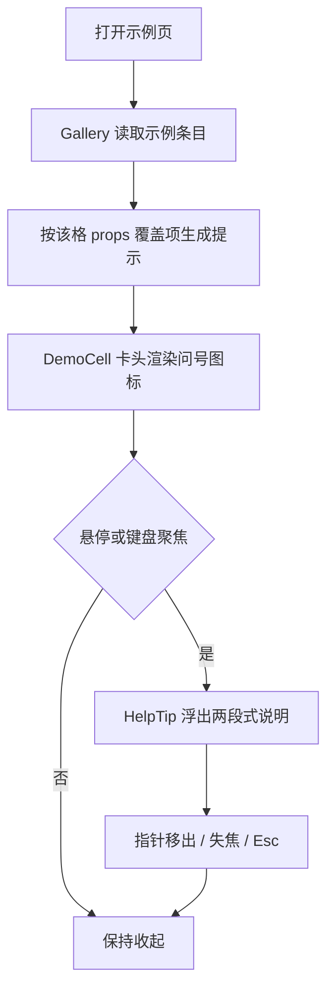
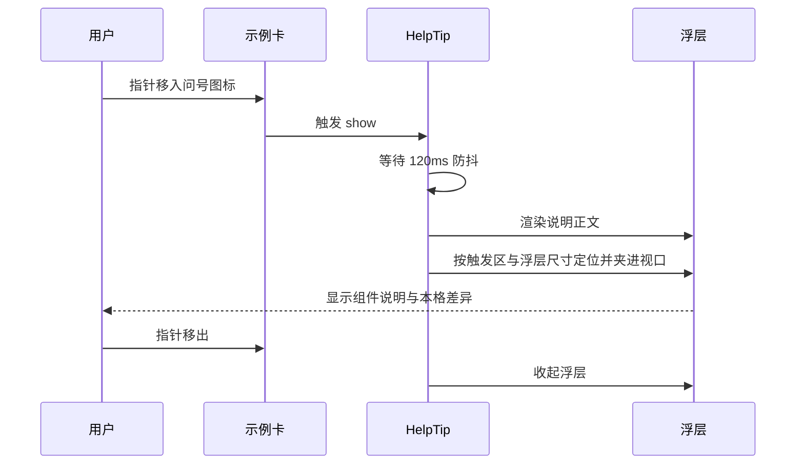

# 组件示例文字提示需求主文档

结论：示例页的每一张组件示例卡，卡头组件名旁新增一个问号图标，悬停或键盘聚焦时浮出文字提示；提示由「这个组件是什么」与「这一格示例在演示什么」两段组成，逐格对应当前示例而不是整页共用一句。影响：101 个示例页、752 张示例卡全部具备可悬停说明，覆盖 152 个组件；范围：新增组件说明数据源与示例差异推导，示例卡头接入既有 `HelpTip` 组件，新增一条运行时守卫；非范围：不修改组件自身运行行为，不修改 139 个上游冻结文件，不替换既有 `Tooltip` / `Popover` 组件；变化：示例从「只能看效果」变为「可悬停读出用途与本格差异」；完成标准：752 张卡全部有提示图标、每格提示均含本格差异、同组件不同变体的提示不重复、守卫能真实抓到回归、其余守卫全绿；术语说明：本格示例指当前这张卡相对基础示例的 props 覆盖差异；验证状态：已用运行时全量扫描、两条阳性对照与截图确认。

## 文档信息

| 字段 | 内容 |
| --- | --- |
| 来源 | `SRC-PEARL-DEMO-GUIDES-20261018`：用户提出「文字提示 / 悬停文字说明与图标式帮助；我们希望所有组件都加一个文字提示的组件提示说明」，并补充「每一个组件示例的提示一个都是对应这次示例的说明」 |
| 目标 | 每张示例卡都有可悬停的文字提示，且提示对应当前这一格示例 |
| 优先闭环 | 侦察现有能力 -> 建立说明数据源 -> 卡头接入 -> 逐格差异推导 -> 全量验证 -> 守卫固化 -> 文档落盘 |
| 决策状态 | `unresolved_decisions`：无 |
| 图片资产决策：N/A，理由：需求以文字提示为交付物，取证以运行时扫描与截图给出，不把截图作为判定依据，故本节不涉及图片资产 |

## 1. 结论

示例页原本只能看效果，无法读出「这个组件是做什么的」，更无法知道「这一格和其他格差在哪」。本轮给每张示例卡补一个问号图标，悬停即显示两段式提示：第一段是组件用途，第二段是本格的 props 覆盖差异。

提示能力没有新造轮子：组件库既有的 `extend/HelpTip.vue` 已具备悬停、键盘聚焦、Esc 关闭、视口夹取、焦点保持等完整交互，本轮直接复用它作为触发与浮层实现。

## 2. 需求范围

| 编号 | 要求 | 落点 |
| --- | --- | --- |
| `REQ-01` | 每个组件的示例卡都带文字提示入口 | `DemoCell.vue` 卡头挂 `HelpTip` |
| `REQ-02` | 提示说明该组件的用途 | `src/data/component-guides.ts` 的 152 条说明 |
| `REQ-03` | 提示对应当前这一格示例 | `views/gallery/demo-guides.ts` 按该格 props 覆盖项推导 |
| `REQ-04` | 提示可悬停与键盘聚焦触发 | 复用 `HelpTip` 既有交互 |
| `REQ-05` | 不修改上游冻结文件 | 17 个无头部注释的冻结组件由说明数据源补齐 |
| `REQ-06` | 回归可被机器检出 | 新增 `check_demo_guides.py` 守卫 |

## 2.1 目标与非目标

| 类别 | 内容 |
| --- | --- |
| 目标 | 每张示例卡都能悬停读出「这个组件是什么」与「这一格在演示什么」 |
| 目标 | 152 个组件全部有说明，17 个冻结面组件不靠改源码补齐 |
| 目标 | 提示回归可被机器检出，两条阳性对照必须能转 FAIL |
| 非目标 | 不修改组件自身运行行为与公开契约 |
| 非目标 | 不修改 139 个上游冻结文件 |
| 非目标 | 不替换既有 `Tooltip`、`Popover`、`HelpTip` 组件 |
| 非目标 | 不给业务页面中的组件调用点自动挂提示 |

## 2.2 需求来源与证据台账

| 编号 | 来源 | 内容 | 证据 |
| --- | --- | --- | --- |
| `SRC-PEARL-DEMO-GUIDES-20261018` | 用户消息 | 「文字提示 / 悬停文字说明与图标式帮助；我们希望所有组件都加一个文字提示的组件提示说明」 | 本轮对话 |
| `SRC-PEARL-DEMO-GUIDES-20261018` | 用户补充 | 「每一个组件示例的提示一个都是对应这次示例的说明」 | 本轮对话 |
| `EVID-01` | 索引扫描 | `references/component-catalog.json` 已有 135/152 条说明 | 脚本统计输出 |
| `EVID-02` | 冻结面核对 | 17 条空说明全部在 139 个上游冻结文件内 | `component-library-baseline.json` 比对 |
| `EVID-03` | 能力盘点 | `extend/HelpTip.vue` 已具备悬停、聚焦、Esc、夹取 | 组件源码阅读 |

## 3. 功能需求

| 编号 | 功能 | 触发 | 期望结果 |
| --- | --- | --- | --- |
| `REQ-01` | 提示入口 | 每张示例卡渲染 | 卡头组件名右侧出现问号图标，点击区不小于 24 像素 |
| `REQ-02` | 组件说明 | 悬停或键盘聚焦图标 | 浮层第一段显示该组件的中文用途说明 |
| `REQ-03` | 本格差异 | 悬停或键盘聚焦图标 | 浮层第二段显示该格相对基础示例的覆盖项；基础示例显示「默认形态，未覆盖任何属性」 |
| `REQ-04` | 关闭 | 指针移出、失焦或按 Esc | 浮层收起；Esc 同时释放焦点 |
| `REQ-05` | 边界 | 浮层靠近视口边缘 | 自动翻面并夹在视口内，不被裁切 |

## 4. 业务规则与优先级

| 编号 | 规则 | 优先级 |
| --- | --- | --- |
| `RULE-01` | 提示必须同时包含组件说明与本格差异两段，缺一不可 | P0 |
| `RULE-02` | 非基础示例不得显示「默认形态，未覆盖任何属性」，否则视为未对应本格 | P0 |
| `RULE-03` | 同一组件内不同变体的提示不得全部相同 | P0 |
| `RULE-04` | 说明为空时不渲染图标，避免出现点了没反应的入口 | P1 |
| `RULE-05` | 长文本值截断到 18 字、属性最多列 3 项，防止浮层被撑成一面墙 | P1 |
| `RULE-06` | 未定义值显示为「未设置」，不得出现 `undefined` 原文 | P1 |
| `RULE-07` | 17 个上游冻结文件不得为补说明而修改，说明一律写入数据源 | P0 |

## 5. 数据与外部契约

| 项 | 内容 |
| --- | --- |
| 说明数据源 | `src/data/component-guides.ts`：`Record<string, string>`，键为组件名，值为一句中文说明 |
| 示例差异来源 | `entries.ts` 的 `DemoEntry.diff`：该格相对基础示例的 props 覆盖项 |
| 提示生成 | `demoGuideOf(name, variant, props)`：拼出「组件说明。本格示例：差异」 |
| 提示组件 | `extend/HelpTip.vue`：`content` 为正文，`tone` 为图标风格，`label` 为读屏名称 |
| 无外部依赖 | 不新增第三方库，不调用后端接口 |

## 6. 风险、假设、依赖与阻断

| 项 | 内容 |
| --- | --- |
| 假设 | 该格 props 覆盖项足以表达「这一格在演示什么」；纯插槽差异不在本轮范围 |
| 依赖 | 本地开发服务（端口 5173）与 Python Playwright，用于运行时守卫 |
| 风险一 | 变体标签改名会让「基础示例」判断失效，故判据同时比对提示正文而非只看标签 |
| 风险二 | 说明数据源与组件契约可能漂移，故守卫按组件名逐一核对提示非空 |
| 风险三 | 长文案可能撑破浮层，故截断到 18 字并限制最多 3 项属性 |
| 阻断 | 无；本轮不涉及数据库、外部接口与跨项目写入 |

## 7. 现状与缺口

| 项 | 现状 | 缺口 |
| --- | --- | --- |
| 组件说明数据 | `references/component-catalog.json` 已有 135 条（从组件头部注释抽取首行） | 17 条为空，且该索引属技能层构建产物、不在 `src` 编译范围内，不能直接 import |
| 17 条空说明的来源 | 全部位于 139 个上游冻结文件（`ui/`、`layout/` 与 `Icon.vue`） | 源码没有头部注释，且不能改冻结文件 |
| 提示组件 | `extend/HelpTip.vue` 交互完整 | 示例页没有使用 |
| 示例差异信息 | `entries.ts` 已有该格覆盖项 `v.props` | 只用于渲染，未对外暴露给提示 |

## 8. 方案

1. 新建 `src/data/component-guides.ts`，作为组件说明的唯一数据源，152 个组件各一句中文说明：135 条复用索引已有内容，17 条冻结面组件由本轮补齐。
2. 新建 `views/gallery/demo-guides.ts`，把「组件说明」与「本格示例差异」拼成一条提示；差异来自该格相对基础示例的 props 覆盖项，基础示例固定写「默认形态，未覆盖任何属性」。
3. `entries.ts` 的 `DemoEntry` 新增 `diff` 字段，把该格覆盖项透出；`Gallery.vue` 把它传给 `DemoCell`。
4. `DemoCell.vue` 卡头组件名旁挂 `HelpTip`，说明为空时不渲染图标。
5. 新建 `check_demo_guides.py` 守卫，四条判据 + 两条阳性对照。

## 9. 关键决策

| 决策 | 选择 | 理由 |
| --- | --- | --- |
| 说明数据放哪 | `src/data/component-guides.ts` | `references/` 在 `src` 的 TS 编译范围外，跨目录 import 会破坏构建边界；数据必须随组件库一起编译 |
| 17 条空说明怎么补 | 写进说明数据源 | 它们全部是冻结文件，源码无头部注释且不可修改 |
| 每格提示怎么对应 | 按该格 props 覆盖项推导 | 752 格逐格手写会产生大量重复且极易漂移；覆盖项本身就是这一格的真实差异 |
| 为什么不改 `component-catalog.json` 的抽取规则 | 不改 | 抽取规则面向「组件说明」，不承担「示例差异」职责，混在一起会让索引语义漂移 |
| 是否新造提示组件 | 不造 | `HelpTip` 已具备完整交互，重复实现会产生两套行为 |

## 9.1 决策冻结

| 编号 | 已冻结决策 | 执行方不得自行更改 |
| --- | --- | --- |
| `DEC-01` | 说明数据源固定为 `src/data/component-guides.ts` | 不得改从 `references/` 跨目录 import，不得新增第二份说明清单 |
| `DEC-02` | 本格差异固定取自 `DemoEntry.diff` | 不得在 `DemoCell` 内重新推导 props 差异 |
| `DEC-03` | 提示组件固定复用 `extend/HelpTip.vue` | 不得为示例页另造提示组件 |
| `DEC-04` | 基础示例固定文案为「默认形态，未覆盖任何属性」 | 不得改写该文案，守卫按它判定是否对应本格 |
| `DEC-05` | 17 个冻结面组件说明写入数据源 | 不得修改 `ui/`、`layout/` 与 `Icon.vue` |
| `DEC-06` | 长文本截断 18 字、属性最多 3 项 | 不得移除截断，否则浮层会被撑破 |

## 9.2 普通模型零决策执行契约

| 步骤 | 精确动作 | 文件 | 完成判定 |
| --- | --- | --- | --- |
| 1 | 在说明数据源中为每个组件写一条中文说明 | `src/data/component-guides.ts` | 152 个键、无空值 |
| 2 | 按 `DemoEntry.diff` 拼接「组件说明 + 本格示例」 | `views/gallery/demo-guides.ts` | `demoGuideOf` 返回两段 |
| 3 | 在卡头渲染 `HelpTip`，说明为空不渲染 | `views/gallery/DemoCell.vue` | 每卡一个 `.x-help` |
| 4 | 把该格覆盖项透出并传给卡片 | `entries.ts`、`Gallery.vue` | `diff` 非空（非基础示例） |
| 5 | 运行守卫并核对两条阳性对照 | `scripts/check_demo_guides.py` | `DEMO_GUIDES: PASS` |
| 6 | 复跑全套守卫与构建 | 各守卫命令 | 全 PASS、`vue-tsc` 0、单测 21/21 |

## 10. 主流程

图形目的：说明从打开示例页到读出提示的完整路径；关联 ID：`REQ-01`、`REQ-02`、`REQ-03`、`REQ-04`。

## 11. 交互时序

图形目的：说明一次悬停触发的时序与定位时机；关联 ID：`REQ-04`、`REQ-05`。

## 12. 追踪矩阵

| 需求 | 规则 | 落点文件 | 验证 |
| --- | --- | --- | --- |
| `REQ-01` | `RULE-04` | `views/gallery/DemoCell.vue` | 全量扫描图标数 752/752 |
| `REQ-02` | `RULE-01` | `src/data/component-guides.ts` | 152 条说明、无空值 |
| `REQ-03` | `RULE-01` `RULE-02` `RULE-03` | `views/gallery/demo-guides.ts`、`entries.ts`、`Gallery.vue` | 逐格悬停实测差异正确 |
| `REQ-04` | `RULE-05` `RULE-06` | `views/gallery/demo-guides.ts` | 长文本截断、`undefined` 零处 |
| `REQ-05` | `RULE-07` | 说明数据源补齐 17 条 | `FIDELITY: PASS`（263 本地 / 139 上游） |
| `REQ-06` | 全部 | `scripts/check_demo_guides.py` | `DEMO_GUIDES: PASS` + 两条阳性对照 |

## 12.1 垂直切片与追踪契约

| 切片 | 范围 | 依赖 | 完成判定 |
| --- | --- | --- | --- |
| `SLICE-PEARL-DEMO-GUIDES` | 说明数据源 + 差异推导 + 卡头接入 + 守卫 | `HelpTip` 组件、`entries.ts` 装配层 | `DEMO_GUIDES: PASS` 且两条阳性对照命中 |

追踪契约：`SRC-PEARL-DEMO-GUIDES-20261018` -> `REQ-01` 至 `REQ-06` -> `RULE-01` 至 `RULE-07` -> `DEC-01` 至 `DEC-06` -> `SLICE-PEARL-DEMO-GUIDES` -> 落点文件 -> 守卫与验证。

## 13. 验证

| 项目 | 结果 |
| --- | --- |
| 提示覆盖 | 752 张示例卡全部有提示图标，`noIcon: 0` |
| 两段结构 | 全部提示含「本格示例」段，`noDemoPart: 0` |
| 逐格对应 | 非基础示例写「默认形态」的数量为 0 |
| 变体区分 | 同组件内不同变体的提示全部不同，`collapsedGuides: {}` |
| 悬停实测 | 真实鼠标悬停 `variant=primary` / `ghost` / `text` 三格，提示分别为对应差异 |
| 长文本截断 | `content` 类长文案截断到 18 字加省略号，浮层宽度稳定在 260px |
| 未定义值 | `undefined` 显示为「未设置」，全量扫描零处 `undefined` |
| 守卫 | `DEMO_GUIDES: PASS (101 页 752 张示例卡)` |
| 阳性对照一 | 差异推导恒返回默认文案，守卫报出大量「非基础示例却写默认形态」 |
| 阳性对照二 | 移除 `<HelpTip>`，守卫报出大量「缺少提示图标」 |
| 其余守卫 | `DEMO_VISIBILITY` / `CONTENT_PADDING` / `FIDELITY` / `POLLUTION` / `CATEGORIES` / `DEMO_VARIANTS` / `CATALOG` 全 PASS |
| 构建 | `vue-tsc` 零报错、单测 21/21、`vite build` 4.50s |

## 14. 未覆盖说明

- 提示只覆盖示例页的卡片入口；组件在业务页面中的实际调用点不自动挂提示，需要调用方显式使用 `Tooltip` 或 `HelpTip`。
- 本格差异只描述 props 覆盖项，不描述插槽内容差异；纯插槽变体（如 `Tabs` 的面板内容）的提示仍以组件说明为主。
- 长文本值截断到 18 字，完整内容需查看该格的实际渲染结果。

## 15. 完成标准

| 标准 | 判定方式 | 实际结果 |
| --- | --- | --- |
| 每个组件示例都有提示入口 | 全量扫描 `.x-help` 数量 | 752/752 |
| 提示说明组件用途 | 检查提示第一段非空 | 152 个组件全部有说明 |
| 提示对应当前示例 | 非基础示例不得写默认形态 | 0 处 |
| 同组件变体提示可区分 | 同组件提示集合去重 | 无重复 |
| 回归可被机器检出 | 两条阳性对照必须转 FAIL | 两条均精确命中 |
| 不破坏既有能力 | 全套守卫与构建 | 全部通过 |
