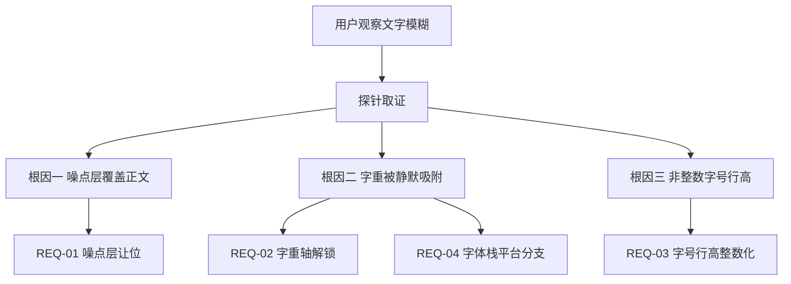
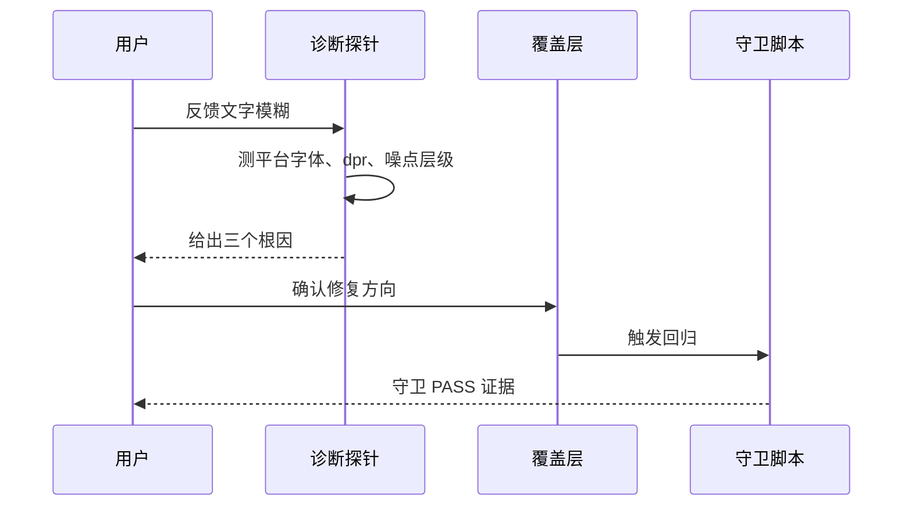

# 需求：组件库文字清晰度修复

结论：文字模糊的根因不是分辨率不足，而是噪点层覆盖正文、非标准字重被静默吸附、非整数字号行高落在半像素栅格三处叠加；影响：所有后台页面与 752 张组件示例卡的正文可读性；范围：噪点层层级、字重轴解锁、字号行高整数化、字体栈平台分支；非范围：不改上游冻结文件、不换设计语言、不打包字体、不调整基准字号；变化：文字边缘更锐利、字重层次真实可辨、跨平台渲染可控；完成标准：三项守卫 PASS 且噪点层不再覆盖正文；术语说明：dpr 指设备像素比，可变字体指单文件内支持连续字重轴；验证状态：根因已用真实探针验证，修复尚未实施。

## 1. 文档信息

- 需求标识：`SRC-FONT-CLARITY-001`
- 需求来源：用户观察反馈「文字字体的像素很低，有些模糊」
- 当前状态：需求已冻结，等待开工授权
- 关联实施总览：`doc/3-实施/2026-10-18_REQ-FONT-CLARITY-001_实施总览.md`
- 未决决策数：0（`unresolved_decisions: 0`）

## 2. 需求来源与证据台账

| 证据 ID | 来源类型 | 内容摘要 | 采集方式 | 可信度 |
| --- | --- | --- | --- | --- |
| `EVD-01` | 用户反馈 | 文字像素低、有些模糊 | 用户原话 | 高 |
| `EVD-02` | 运行时探针 | 浏览器实际命中 Noto Sans SC，非微软雅黑 | CDP `CSS.getPlatformFontsForNode` | 高 |
| `EVD-03` | 像素对照 | 仅关噪点层，截图 MD5 由 `f1cb7bac` 变 `f64b0ebae`，体积 52,861→26,575 字节 | Playwright 截图 + MD5 | 高 |
| `EVD-04` | 像素对照 | 仅关 `-webkit-font-smoothing` 或 `text-rendering`，截图字节完全相同 | Playwright 截图 + MD5 | 高 |
| `EVD-05` | 像素矩阵 | 无 `@font-face` 时 7 档字重仅 2–3 组像素 | Playwright 逐行截图 + MD5 | 高 |
| `EVD-06` | 像素矩阵 | `local()` + `font-weight: 100 900` 时 5 档字重 5 组像素 | 真实应用内独立元素截图 | 高 |
| `EVD-07` | 代码普查 | 165 处字重声明，非标准档位 96 处 | `grep` 统计 | 高 |
| `EVD-08` | 代码普查 | 字号 11.5px 占 11.9%、12.5px 占 2.6% | Playwright 全站普查 | 高 |
| `EVD-09` | 代码普查 | 行高 19.5px 占 48.4%、16.5px 占 25% | Playwright 全站普查 | 高 |

## 3. 目标与非目标

### 3.1 目标

- `REQ-01`：文字区域不再被全屏噪点层扰动，噪点视觉仍保留在背景层。
- `REQ-02`：165 处既有字重声明在支持可变字体的环境下呈现真实连续档位，不再被静默吸附。
- `REQ-03`：全站字号与行高落在整数像素，辅助字号不小于 12px。
- `REQ-04`：字体栈按平台分支，消除 Windows 上的空转项。

### 3.2 非目标

- `BOUND-01`：不修改 `src/styles/*.css` 七个冻结样式文件。
- `BOUND-02`：不修改 63 个上游冻结组件。
- `BOUND-03`：不更换珍珠玻璃设计语言或配色。
- `BOUND-04`：不打包字体文件、不引入网络字体。
- `BOUND-05`：不调整 13px 基准字号。

## 4. 功能需求与规则要求

| 需求 ID | 功能描述 | 验收条件 | 优先级 |
| --- | --- | --- | --- |
| `REQ-01` | 噪点层让位 | `AC-01`：文字区域像素与关闭噪点层基线一致 | P0 |
| `REQ-02` | 字重轴解锁 | `AC-02`：400/500/560/620/700 五档产生五组不同像素 | P0 |
| `REQ-03` | 字号行高整数化 | `AC-03`：全站字号与行高小数部分为 0，辅助字号 ≥12px | P1 |
| `REQ-04` | 字体栈平台分支 | `AC-04`：Windows 命中 Segoe UI 或 Noto Sans SC，macOS 命中 SF Pro 或 PingFang | P1 |

## 5. 业务规则与优先级

- `RULE-01`：所有修复必须落在 `overrides.css` 覆盖层，不得触碰冻结面。
- `RULE-02`：字重声明保留原值，通过字体能力解锁，不做归并。
- `RULE-03`：`@font-face` 必须带完整回退链，字体缺失时按平台字体栈降级。
- `RULE-04`：优先级固定为 P0（噪点层、字重）先于 P1（字号行高、字体栈）。

## 6. 数据与外部契约

N/A + 原因：本需求不涉及数据库、HTTP 接口或外部服务 + 证据：全部落点为 CSS 与 Vue 模板。

## 7. 风险、假设、依赖与阻断

| 类型 | 内容 | 处置 |
| --- | --- | --- |
| 风险 | 字号整数化可能改变换行与元素高度 | 周期 02 单独回归，覆盖 752 卡 |
| 风险 | `local()` 依赖本机安装 Noto Sans SC | 完整回退链；文档登记前提 |
| 假设 | 覆盖层能压过冻结 CSS | 已用 L2 探针验证 |
| 假设 | `local()` 可解锁连续字重轴 | 已用 L2 探针验证 |
| 依赖 | 本机 Noto Sans SC 可变字体 | 已确认 `NotoSansSC-VF.ttf` 存在 |
| 阻断 | `FIDELITY: FAIL` | 立即停止并回写计划 |

## 8. 决策冻结

| 决策 ID | 决策内容 | 用户选择 | 冻结状态 |
| --- | --- | --- | --- |
| `DEC-01` | 字重处理路线 | 解锁可变字重轴 | 已冻结 |
| `DEC-02` | 字号行高策略 | 整数化 + 辅助字号提到 12px | 已冻结 |
| `DEC-03` | 字体栈策略 | 按平台分支 | 已冻结 |

## 9. 流程图

图形目的：说明从文字模糊现象到三个根因、再到四类修复的动作顺序；关联 ID：`SRC-FONT-CLARITY-001`、`REQ-01` 至 `REQ-04`。

## 10. 时序图

图形目的：说明用户反馈、诊断探针与覆盖层修复之间的交互时序；关联 ID：`SRC-FONT-CLARITY-001`、`AC-01` 至 `AC-04`。

## 11. 追踪矩阵

| 来源 | 需求 | 验收条件 | 决策 | 实施任务 |
| --- | --- | --- | --- | --- |
| `SRC-FONT-CLARITY-001` | `REQ-01` | `AC-01` | `DEC-01` | `TASK-01` |
| `SRC-FONT-CLARITY-001` | `REQ-02` | `AC-02` | `DEC-01` | `TASK-02` |
| `SRC-FONT-CLARITY-001` | `REQ-03` | `AC-03` | `DEC-02` | `TASK-03` |
| `SRC-FONT-CLARITY-001` | `REQ-04` | `AC-04` | `DEC-03` | `TASK-02` |

## 12. 追踪契约

| 稳定 ID | 上游来源 | 下游落点 | 证据回指 |
| --- | --- | --- | --- |
| `REQ-01` | `EVD-03` | `TASK-01` | `EVIDENCE-01` |
| `REQ-02` | `EVD-05`、`EVD-06`、`EVD-07` | `TASK-02` | `EVIDENCE-02` |
| `REQ-03` | `EVD-08`、`EVD-09` | `TASK-03` | `EVIDENCE-03` |
| `REQ-04` | `EVD-02` | `TASK-02` | `EVIDENCE-04` |

## 13. 普通模型零决策执行契约

- 执行模型不得自行决定字重归并路线；必须按 `DEC-01` 保留原值并解锁字重轴。
- 执行模型不得自行决定字号取值；必须按 `DEC-02` 的映射表执行。
- 执行模型不得自行决定字体栈顺序；必须按 `DEC-03` 的平台分支执行。
- 任一探针失败时，执行模型必须停止并回写计划，不得自行改走备选路线。

## 14. 验收条件

- `AC-01`：噪点层不再覆盖文字，文字区域像素差异为 0。
- `AC-02`：五档字重产生五组不同像素，`document.fonts` 状态为 `loaded`。
- `AC-03`：全站字号与行高小数部分为 0，辅助字号 ≥12px。
- `AC-04`：Windows 与 macOS 字体栈分别命中预期字体。

## 15. 图片资产决策

图片资产决策：N/A + 原因：本需求为 CSS 层清晰度修复，验收证据为像素哈希与守卫输出文本，不需要视觉参考图或截图归档 + 证据：第 14 节全部验收条件均以哈希、计算样式和退出码判定，无图片依赖。
