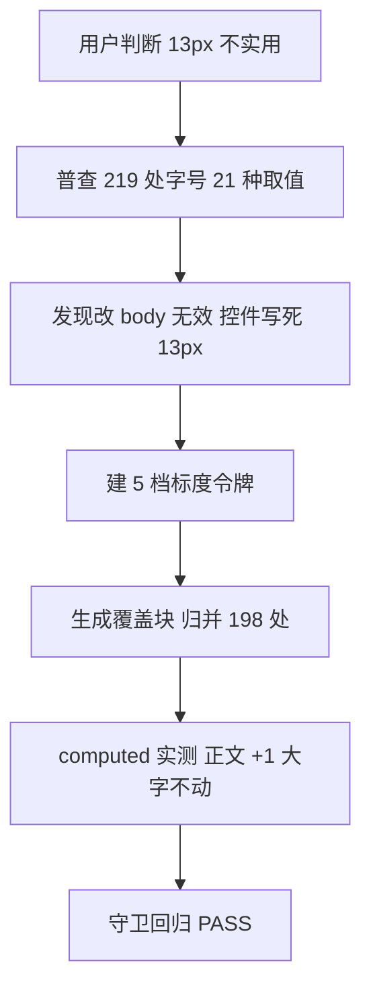
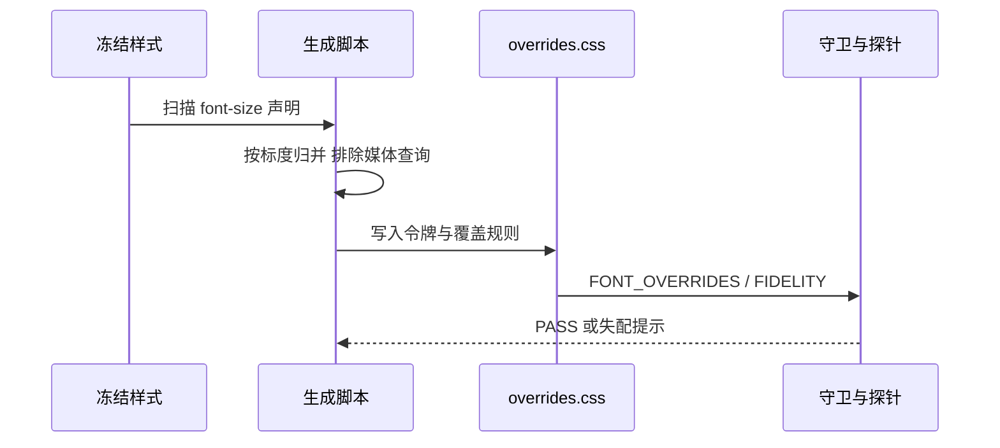

# 需求：字号标度化与正文字号基准上调

结论：组件库正文基准从 13px 上调到 14px，并把 10–15px 区间的 21 种散值归并为 5 档令牌，最小字号兜底 12px；影响：全部后台页面与 152 个组件示例的文字可读性，以及字号从此可单点调整；范围：样式层 198 处字号声明、字号令牌族、生成脚本与守卫；非范围：组件内部 scoped 字号 116 处（第二批）、16px 以上大字区、控件高度与表格行高；变化：正文与控件文字整体上移一档，图表轴标签与时间戳从 10–11px 提到 12px；完成标准：`FONT_OVERRIDES` 与 `FIDELITY` 双 PASS，且浏览器实测字号符合标度表；术语说明：标度指一组有固定档位与语义角色的字号令牌；验证状态：样式层已实施并用 computed style 实测，组件层待第二批。

## 1. 文档信息

- 需求标识：`SRC-FONT-SCALE-001`
- 需求来源：用户判断「13px 虽然好看但不实用，用户一般都不喜欢太小的字体，只能当作美术品」
- 当前状态：样式层已实施，待组件层第二批
- 前置需求：`REQ-FONT-CLARITY-001`（本文档取代其 `BOUND-05`，见 `DEC-04`）
- 未决决策数：0（`unresolved_decisions: 0`）

## 2. 需求来源与证据台账

| 证据 ID | 来源类型 | 内容摘要 | 采集方式 | 可信度 |
| --- | --- | --- | --- | --- |
| `EVD-01` | 用户判断 | 13px 好看但不实用，用户不喜欢太小的字体 | 用户原话 | 高 |
| `EVD-02` | 代码普查 | `base.css:14` 基准 13px，`line-height: 1.5` 即 19.5px 半像素行高 | `grep` | 高 |
| `EVD-03` | 代码普查 | 样式层 219 处 `font-size` 声明，21 种不同取值；345 处含组件层 | 脚本统计 | 高 |
| `EVD-04` | 代码普查 | 其中 46.7% 的文本落在 12px 及以下，最小 10px | 脚本统计 | 高 |
| `EVD-05` | 代码普查 | 相邻档位存在 0.5px 差（10/10.5、11/11.5、12/12.5、13/13.5），视觉不可辨 | 脚本统计 | 高 |
| `EVD-06` | 代码普查 | 改 `body` 无法影响控件：`.btn`/`.table`/`.input-shell` 各自写死 13px | `grep` | 高 |
| `EVD-07` | 运行时探针 | 覆盖层生效后 computed 实测：正文类 +1px、轴标签 +2px、22px 与 56px 未变 | Chrome computed style | 高 |
| `EVD-08` | 代码普查 | 媒体查询内仅 2 处字号（22px / 44px），均大于 15px，不在迁移范围 | 脚本统计 | 高 |

## 3. 目标与非目标

### 3.1 目标

- `REQ-01`：正文与控件文字基准从 13px 上调到 14px。
- `REQ-02`：10–15px 区间的 21 种散值归并为 5 档令牌，最小档兜底 12px。
- `REQ-03`：字号成为可单点调整的令牌，改标度不触碰冻结样式。
- `REQ-04`：16px 以上大字区保持不变，避免无收益的视觉风险。

### 3.2 非目标

- `BOUND-01`：不改 `src/styles/` 下五个冻结样式文件一个字节，全部落 `overrides.css`。
- `BOUND-02`：不改 63 个上游冻结组件。
- `BOUND-03`：本轮不迁移组件 scoped 内的 116 处字号，留作第二批（`BOUND-06`）。
- `BOUND-04`：本轮不调整控件高度与表格行高，仅标签高度从 22px 联动到 24px。
- `BOUND-05`：**已被 `DEC-04` 取代**——原「不调整 13px 基准字号」的冻结边界就此解除。
- `BOUND-06`：组件 scoped 字号 116 处，涉及 60 个组件，其中 13px 有 71 处，需逐组件判断语义后迁移。

## 4. 功能需求与规则要求

| 需求 ID | 功能描述 | 验收条件 | 优先级 |
| --- | --- | --- | --- |
| `REQ-01` | 基准上调 | `AC-01`：浏览器实测 `body`、`.btn`、`.table`、`.input-shell` 均为 14px | P0 |
| `REQ-02` | 散值归并 | `AC-02`：`FONT_OVERRIDES: PASS`，令牌为 caption 12 / sm 13 / body 14 / lg 15 / title 16 | P0 |
| `REQ-03` | 单点可调 | `AC-03`：修改 `--fs-*` 五处即改变全站字号，无需触碰冻结文件 | P0 |
| `REQ-04` | 大字不动 | `AC-04`：`.page-title` 22px、`.metric-figure` 56px 的 computed 值保持不变 | P1 |

## 5. 业务规则与优先级

- `RULE-01`：覆盖块由 `scripts/build_font_overrides.py` 从冻结源自动派生，禁止手改块内内容。
- `RULE-02`：归并原则是「相邻 0.5px 合并」，因为这类差异在屏幕上不可分辨，属标注残留。
- `RULE-03`：机械映射后若出现语义颠倒（如校验提示与字段标签同档），用 `ROLE_OVERRIDES` 最小修正，不做全局特判。
- `RULE-04`：媒体查询内的字号不参与迁移，脚本一旦发现标度范围内字号即报错，不静默漏掉。

## 6. 数据与外部契约

N/A + 原因：本需求只涉及 CSS 令牌与生成脚本，不涉及数据库、HTTP 接口或外部服务 + 证据：全部落点为 `overrides.css`、`build_font_overrides.py` 与 `LOCAL-GUIDE.md`。

## 7. 风险、假设、依赖与阻断

| 类型 | 内容 | 处置 |
| --- | --- | --- |
| 风险 | 字号变大导致窄容器文字换行、表格列拥挤 | 已用 740px 宽容器实测 5 列表格无换行、无溢出 |
| 风险 | 标签 22px 高配 13px 字贴边 | 标签高度联动到 24px，已实测 |
| 风险 | 组件 scoped 内仍是 11–13px，与页面级不一致 | 登记为 `BOUND-06` 第二批，不在本轮宣称已统一 |
| 假设 | `overrides.css` 在 `main.ts` 最后引入，同特异性规则后者胜 | 由 `INVENTORY` 八层顺序断言保证 |
| 依赖 | 冻结样式为唯一字号来源 | 脚本每次从冻结源重算，`--check` 校验同步 |
| 阻断 | `FIDELITY: FAIL` 或 `FONT_OVERRIDES: FAIL` | 立即停止并回滚覆盖块 |

## 8. 决策冻结

| 决策 ID | 决策内容 | 用户选择 | 冻结状态 |
| --- | --- | --- | --- |
| `DEC-01` | 正文基准字号 | 14px | 已冻结 |
| `DEC-02` | 散值归并方式 | 相邻 0.5px 合并为 5 档，最小 12px | 已冻结 |
| `DEC-03` | 落点方式 | 生成覆盖块，不碰冻结样式 | 已冻结 |
| `DEC-04` | 解除旧边界 | 接受解除 `REQ-FONT-CLARITY-001` 的 `BOUND-05`（原「不调整 13px 基准」） | 已冻结 |

## 9. 流程图

图形目的：说明从「字太小」的判断到标度化落地的路径；关联 ID：`SRC-FONT-SCALE-001`、`REQ-01` 至 `REQ-04`。

## 10. 时序图

图形目的：说明生成脚本、覆盖层与守卫之间的交互顺序；关联 ID：`REQ-02`、`AC-02`。

## 11. 追踪矩阵

| 来源 | 需求 | 验收条件 | 决策 | 实施落点 |
| --- | --- | --- | --- | --- |
| `SRC-FONT-SCALE-001` | `REQ-01` | `AC-01` | `DEC-01` | `overrides.css` 覆盖块 |
| `SRC-FONT-SCALE-001` | `REQ-02` | `AC-02` | `DEC-02` | `build_font_overrides.py` |
| `SRC-FONT-SCALE-001` | `REQ-03` | `AC-03` | `DEC-03` | `--fs-*` 令牌 |
| `SRC-FONT-SCALE-001` | `REQ-04` | `AC-04` | `DEC-02` | 标度范围上限 15px |

## 12. 追踪契约

| 稳定 ID | 上游来源 | 下游落点 | 证据回指 |
| --- | --- | --- | --- |
| `REQ-01` | `EVD-01`、`EVD-06` | `AC-01` | `EVD-07` |
| `REQ-02` | `EVD-03`、`EVD-05` | `AC-02` | `EVD-03` |
| `REQ-03` | `EVD-06` | `AC-03` | `EVD-07` |
| `REQ-04` | `EVD-03` | `AC-04` | `EVD-07` |

## 13. 普通模型零决策执行契约

- 执行模型不得自行决定基准字号；必须按 `DEC-01` 取 14px。
- 执行模型不得自行决定归并规则；必须按 `DEC-02` 的相邻 0.5px 合并，最小档 12px。
- 执行模型不得直接手改 `overrides.css` 的生成块；必须改脚本后重跑。
- 执行模型不得把组件 scoped 字号混入本轮范围；`BOUND-06` 明确排除。
- 任一守卫 FAIL 时必须停止并回滚覆盖块，不得用「差异很小」为由放行。

## 14. 验收条件

- `AC-01`：改前改后 computed 实测，`body` 13→14、`.btn` 13→14、`.table td` 13→14、`.input-shell input` 13→14。
- `AC-02`：`FONT_OVERRIDES: PASS (198 selectors, 5 size groups)`；令牌取值为 12/13/14/15/16。
- `AC-03`：改 `--fs-body` 一处即可改变全站正文，`FIDELITY` 仍 PASS。
- `AC-04`：`.page-title` 22px、`.metric-figure` 56px、图表轴从 10px 到 12px 的实测值与预期一致。

## 15. 图片资产决策

图片资产决策：N/A + 原因：本需求验收以 computed style 数值、守卫输出与 CSS 文本为准，不需要视觉参考图归档 + 证据：第 14 节全部条件均可用命令复现。
