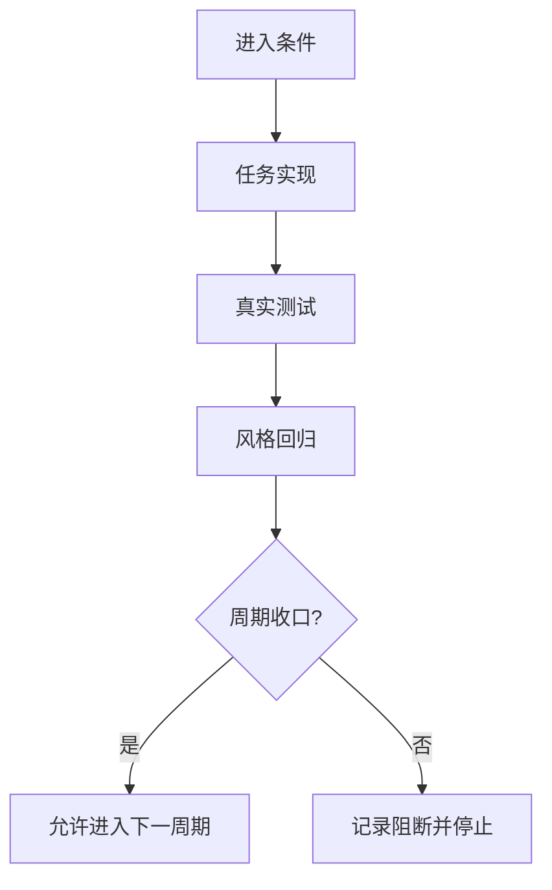
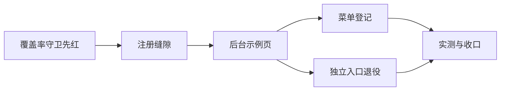

# 实施周期 01：珍珠玻璃组件库后台化

结论：把组件核对示例从独立网页入口迁进管理后台的真实路由，让后台成为「所有组件加用法示例」的完整组件库示例，并新增覆盖率守卫判定全部组件是否都在后台可达。影响：后台菜单新增一个组件库分组，独立网页入口退役，上游登记表中开出一条本地页面注册缝隙。范围：本地新增页面与注册表、模拟菜单数据、守卫脚本与守卫受管清单、文档计数口径。非范围：不修改任何上游业务页面的既有实现，不修改上游组件源码，不做版本提交。变化：示例从两套入口收敛为一套后台入口，组件清单的枚举口径复用既有目录索引生成器。完成标准：后台组件覆盖率守卫全绿、覆盖率百分之百、后台内示例浏览器实测可用、独立网页入口已退役且无残留引用、上游还原度守卫仍通过且漂移全部声明式可见。术语说明：覆盖率指以后台入口页为起点、沿组件相互引用闭包后能到达的组件数量占全部组件数量的比例。验证状态：执行前由本地真实浏览器与守卫链实测确认，未实测项不得宣称为通过。

## 当前周期目标

- 周期 ID / 期次定位：`CYCLE-01` / 第一期
- 只做这一件事：让全部 151 个组件都通过后台路由可达，并把用法示例呈现在后台内部。
- 对应需求、验收和实施总览：`REQ-PEARL-ADMIN-GALLERY-001`；验收条件见本周期验证矩阵；本仓库组件库为单周期改造，不设实施总览，入口即本周期文档。
- 本周期不做：上游业务页面改造、上游组件源码改造、版本提交、知识库改写。

## 周期图片资产决策与边界

- 图片资产决策：`N/A + 原因 + 证据`。原因：本周期是页面与路由装配改造，无外观基线对比需求；证据：全部关系用 Mermaid 流程图与依赖图表达，渲染核对结果以浏览器真实挂载数与交互断言为证据，不依赖截图。
- Mermaid 边界：任务依赖、边界关系、周期门禁仍使用 Mermaid；本周期不用图片替代任何依赖图。

## 进入条件与收口条件

| 类型 | 条件 | 证据/命令 | 状态 |
| --- | --- | --- | --- |
| 进入 | 分类、目录、还原度三项守卫当前为通过 | 守卫链实测输出 | 已满足 |
| 进入 | 本地开发服务可用真实浏览器取证 | 端口监听与页面返回码 | 已满足 |
| 收口 | 后台组件覆盖率守卫通过且达到百分之百 | `check_admin_component_coverage.mjs` | 已满足（151/151） |
| 收口 | 全部任务实现、真实测试与风格回归三项闭环通过 | 测试主文档与本周期执行附录 | 已满足（见 `doc/5-tests/2026-10-16_193800_REQ-PEARL-ADMIN-GALLERY-001_组件库后台化_测试主文档.md`） |

图形目的：说明周期收口门禁与任务闭环顺序。关联 ID：`CYCLE-01`、`TASK-006`。

## 当前代码/文档基线

- 分支 / 提交：`main` / `3a9aa97e`。
- 已核实文件和符号：全部 151 个组件（分类守卫与目录索引守卫实测通过）；上游跟踪文件 139 个字节冻结（还原度守卫实测通过）；后台入口集合为视图目录全部页面加应用根组件加外壳组件，实测闭包可达 59 个组件、不可达 92 个。
- 依赖版本与 local 配置：Node 24、Vue 3、Vite 6；接口数据全部走内置模拟服务，无外部后端连接。
- 与计划不一致时的停止规则：发现符号不存在、接口已变化或基线不一致，立即停止并回写缺口，不得猜测替代落点。

## 周期内最小任务执行顺序

| 任务 ID | 任务 | 依赖 | 完成条件 | 停止条件 |
| --- | --- | --- | --- | --- |
| `TASK-001` | 新建后台组件覆盖率守卫 | 无 | 先跑出真实缺口清单并可复现 | 若枚举需要手抄组件清单则停止，改复用目录索引生成器的同一遍历入口 |
| `TASK-002` | 建立本地页面注册表并把登记表改成通用缝隙 | `TASK-001` | 后续新增页面不再触碰上游文件 | 若必须逐条硬编码映射才生效则停止，改为缝隙方案 |
| `TASK-003` | 核对示例迁入后台路由页 | `TASK-002` | 后台内按分类渲染全部组件且可操作 | 若必须修改上游组件才能渲染则停止并登记遗留 |
| `TASK-004` | 模拟菜单登记组件库分组与分类入口 | `TASK-003` | 侧栏出现分组且点击进入 | 无 |
| `TASK-005` | 独立网页入口退役 | `TASK-003` | 入口文件不存在且全仓引用扫描命中为零 | 若后台页尚未承接其能力则不得删除 |
| `TASK-006` | 真实浏览器实测与守卫链收口 | `TASK-001`..`TASK-005` | 测试主文档落盘完整证据 | 仅静态验证时必须降级，不得宣称功能可用 |

## 文件与符号操作契约

| 任务 ID | 文件/符号 | 操作 | 改动意图 | 回滚方式 |
| --- | --- | --- | --- | --- |
| `TASK-001` | `frontend-design/scripts/check_admin_component_coverage.mjs` 及 `admin_coverage_graph.mjs`、`admin_coverage_reach.mjs`、`admin_coverage_parse.mjs` | 新增 | 以后台入口为根做引用闭包，判定组件覆盖率；访问器、遍历侧与解析侧按单文件与单函数行数基准分列 | 删除四个文件 |
| `TASK-001` | `frontend-design/scripts/fidelity_upstream.py` | 新增 | 还原度守卫的上游参照物侧按单文件行数基准独立成文件 | 合并回 `verify_fidelity.py` |
| `TASK-002` | `src/data/view-registry.ts` | 新增 | 本地页面清单唯一维护处 | 删除文件 |
| `TASK-002` | `src/composables/auth.ts` 的页面登记表 | 修改（声明式受管覆盖） | 展开本地注册表，使登记缝隙通用化 | 按上游基线字节复原并撤回收清单 |
| `TASK-003` | `src/views/gallery/Gallery.vue` 及支撑模块 | 新增 | 在外壳内按分类呈现可操作示例 | 删除目录 |
| `TASK-004` | `mock/server.mjs` 的菜单种子数据 | 修改 | 增加组件库分组与十个分类入口 | 删除新增菜单项 |
| `TASK-005` | `showcase.html`、`showcase/` | 退役（可逆搬迁） | 消除双轨示例入口 | 从系统临时目录 `pg-retired-showcase` 原路径搬回 |
| `TASK-006` | `doc/5-tests/` 测试主文档 | 新增 | 落盘真实运行证据 | 删除文档 |
| `TASK-006` | `frontend-design/component-library/.test-pollution-allowlist` | 新增 | 登记上游冻结文件的存量污染命中豁免 | 删除文件并回退为阻断 |

## 当前周期验证矩阵

| ID | 验收条件 | 覆盖任务 | 测试 | 证据载体 |
| --- | --- | --- | --- | --- |
| `AC-01` | 全部组件在后台可达，覆盖率守卫通过 | `TASK-001` `TASK-002` `TASK-003` | `TEST-01` | 覆盖率守卫输出 |
| `AC-02` | 后台内提供全部组件用法示例且可操作 | `TASK-003` `TASK-004` `TASK-006` | `TEST-05` | 浏览器实测记录 |
| `AC-03` | 独立网页入口退役、无双轨 | `TASK-005` | `TEST-08` | 文件系统与引用扫描 |
| `AC-04` | 上游还原度守卫仍通过且漂移声明式可见 | `TASK-002` | `TEST-06` | 还原度守卫输出 |
| `AC-05` | 分类导航口径与既有单一真相源一致 | `TASK-003` `TASK-004` | `TEST-09` | 分类守卫输出 |
| `AC-06` | 构建、类型检查、单测与污染扫描全绿 | `TASK-006` | `TEST-03` `TEST-04` `TEST-10` | 命令输出 |

图形目的：说明任务与验收的依赖关系。关联 ID：`TASK-001`、`TASK-002`、`TASK-003`、`TASK-004`、`TASK-005`。

## 周期阻断、停止与回滚

- 停止条件：出现「必须修改上游冻结业务页面或上游组件源码才能达成覆盖」时，停止该项并登记遗留，不擅自破坏字节基线。
- 最大推进边界：仅在本项目组件库目录、脚本目录、引用目录与文档目录内动作；不写入兄弟项目；不做版本提交。
- 回滚：本地新增文件直接删除；上游文件按基线字节复原；模拟菜单删除新增项即回退；守卫受管清单同步撤回。回滚入口为离线还原度守卫复验。

## 自审结论

- 方案架构优先：把逐页硬编码登记改为一次性通用缝隙，后续新增页面不再制造上游漂移。
- 覆盖率判定复用文件系统真实遍历与引用闭包，不手抄组件清单，符合夹具与守卫稳健性要求。
- 关键假设：上游页面登记表可作为声明式受管覆盖；若守卫自测因此失去漂移检出能力，须在实现任务内改用未受管文件取样。

## 执行附录

本节承载任务、文件、命令与测试的机器细节。

### 最小任务闭环

| 任务 ID | 闭环三件套 | 先决验证 | 通过标准 |
| --- | --- | --- | --- |
| `TASK-001` 至 `TASK-006` | 实现、真实测试、风格回归逐项闭环 | 上一任务真实测试通过 | 覆盖率守卫与全链守卫同时通过

### 真实测试与断言

| 测试 ID | 对应任务 | 命令 / 操作 | 样本与数据来源 | 断言 | 失败预期 |
| --- | --- | --- | --- | --- | --- |
| `TEST-01` | `TASK-001` | `node frontend-design/scripts/check_admin_component_coverage.mjs` | 仓库源码树 | 退出码 0 且覆盖率 151/151 | 迁移前必须为失败；缺文件时给出清晰原因 |
| `TEST-02` | `TASK-002` | `node frontend-design/scripts/build_component_catalog.mjs --check` | 组件源码 | 目录索引通过且数量为 151 | 清单漂移即失败 |
| `TEST-03` | `TASK-003` | `npm run build` | 全量源码 | 类型检查通过并构建成功 | 任何类型错误即失败 |
| `TEST-04` | `TASK-004` | `npm run test:unit` | 既有单测 | 21 通过 0 失败 | 回归即失败 |
| `TEST-05` | `TASK-006` | 本地服务加浏览器打开组件库分类路由 | 内置模拟运行时 | 侧栏出现分组；各分类卡片全部挂载；抽样交互状态真实变化 | 空白卡片或控制台报错即失败 |
| `TEST-06` | 全局 | `python -X utf8 -B frontend-design/scripts/verify_fidelity.py` | 上游基线 | 还原度通过且漂移仅声明式可见 | 未声明漂移即失败 |
| `TEST-07` | 全局 | `python -X utf8 -B frontend-design/scripts/verify_fidelity_selftest.py` | 守卫自测夹具 | 自测通过且取样文件仍为未受管文件 | 漂移检出能力被削弱即失败 |
| `TEST-08` | `TASK-005` | 文件系统检查与全仓引用扫描 | 仓库全量 | 独立入口不存在且扫描命中 0 | 存在残留引用即失败 |
| `TEST-09` | `TASK-003` | `node frontend-design/scripts/check_component_categories.mjs` | 分类单一数据源 | 分类守卫通过且口径一致 | 口径分叉即失败 |
| `TEST-10` | 全局 | `python -X utf8 -B test-strategy-rules/scripts/scan_test_pollution.py --root . --diff-only` | 本轮变更集 | 污染扫描通过 | 新增仅测试可达符号即失败 |

### 跨会话执行入口

- 新会话接手第一步：读本周期文档与后台组件覆盖率守卫输出，确认中断在哪一项任务。
- 主项目名称与项目根：`luode-skills` / `D:\谷歌云盘\luode-skills`。
- 主项目仓库类型与代码基线：单仓技能与组件库资产库 / `main` 分支 `3a9aa97e`，组件库上游基线 `577079e9a347`。
- 当前周期与任务标识、中断点核验顺序：`CYCLE-01`，按 `TASK-001` 至 `TASK-006` 顺序，先跑覆盖率守卫取真实状态。
- 本地环境与依赖入口：`frontend-design/component-library`，`npm run dev` 启动，接口数据走内置模拟服务。
- 外部项目代码引用：`N/A + 原因 + 证据`。原因：本周期全部改动在当前项目内；证据：文件与符号操作契约表所列落点均为本项目路径。

## 追踪附录

- `SRC`：用户目标（2026-10-16）管理后台用上全部组件并取代独立网页入口。
- `DEC`：迁入后台真实路由，加通用登记缝隙，加覆盖率守卫。
- `REQ/RULE`：`REQ-PEARL-ADMIN-GALLERY-001`、上游字节冻结基线、夹具与守卫参照物稳健性。
- `AC`：`AC-01` 至 `AC-06`。
- `CYCLE`：`CYCLE-01`。
- `TASK`：`TASK-001` 至 `TASK-006`。
- 文件与符号：本地页面注册表、上游页面登记表、后台示例页、模拟菜单种子、覆盖率守卫、独立网页入口。
- `TEST`：`TEST-01` 至 `TEST-10`。
- `EVIDENCE`：本周期测试主文档（由 `TASK-006` 落盘）。
