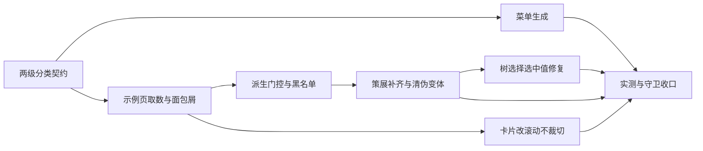
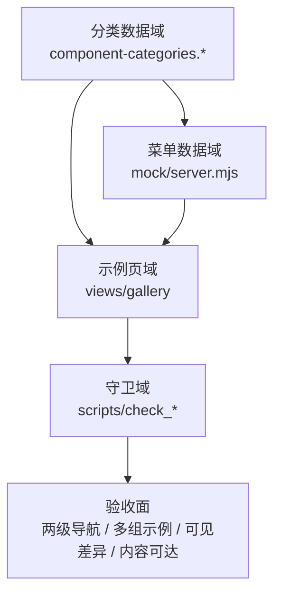

# 实施周期 02：组件菜单二级化与示例可用性收口

结论：本周期把组件库示例的导航从十个一级分类细化为「父分类 + 子组件分类」两级共三十九个示例页，并把「一个组件多种示例」真正做实：一百五十一个组件共五百七十九组示例、平均每组组件三点八三组，且每一组示例都能在浏览器里看出与同组件其它示例的差别。影响：侧栏组件库分组从十条菜单项扩展为十个父目录加三十三个可点页面；示例卡片内容超出卡片尺寸时改为可滚动而不是裁掉；示例页面包屑不再指向无法路由的空页面。范围：本周期只改动本地示例页、分类数据源、模拟菜单与守卫脚本，并修复一处组件自身的选中值显示缺陷。非范围：不改动上游冻结的一百三十九个文件，不改造上游业务页面，不新增组件能力，不执行版本提交。变化：分类导航从一级变两级；示例差异从「看起来不同但渲染相同」变为一律要求有可见差异；窄屏核对从可能丢内容变为内容可达。完成标准：见「当前周期验证矩阵」十二条验收条件全部有磁盘依据与浏览器实测依据。术语说明：伪变体指属性确实写了不同值、但渲染结果与基础示例完全相同的示例格；可见差异指在同屏或同一操作状态下能用肉眼或数值读出区别。验证状态：全部结论来自本轮真实命令输出与真实浏览器实测，无仅凭静态阅读得出的通过项。

## 当前周期目标

- 周期 ID / 期次定位：`CYCLE-02` / 第二期（承接 `CYCLE-01` 后台化结果）。
- 只做这一件事：把组件库菜单做成两级，并保证每个组件的多组示例都真实可用、看得区别、不被遮盖。
- 对应需求、验收和实施总览：`REQ-PEARL-ADMIN-GALLERY-001`；验收条件见本周期验证矩阵；本仓库组件库改造不设实施总览，入口为周期 01 与本周期文档。
- 本周期不做：上游组件源码改造（除一处已确认的实现缺陷）、列排序等冻结能力补齐、版本提交、知识库改写。

## 周期图片资产决策与边界

- 图片资产决策：`N/A + 原因 + 证据`。原因：本周期验收面是导航层级、示例差异可见性与内容可达性，均可由命令输出与文档对象模型数值判定，不需要外观基线对比。证据：分类守卫与变体守卫的计数输出、三十九个示例页的卡片与重复签名扫描结果、五档视口宽度下的零尺寸与裁切计数，全部为真实数值。
- 边界：不引入截图比对，不做像素级视觉回归；外观问题若需判定，另立周期处理。

## 进入条件与收口条件

- 进入条件：`CYCLE-01` 的后台入口与覆盖率守卫已全绿（151/151 组件在后台可达），示例页已承接独立入口能力。实际满足：周期 01 文档与测试主文档已落盘，覆盖率守卫本轮复跑仍为全绿。
- 收口条件：
  1. 两级分类数据源与磁盘组件全集双向对账通过，每个组件恰好归属一个子分组；
  2. 侧栏两级菜单在真实浏览器可点、点击进入对应示例页；
  3. 每个组件示例组数不少于三（单一维度契约组件按降档规则记录并给出理由）；
  4. 每个组件的任意两组示例在同屏或同一操作状态下都存在可见差异，扫描到的重复组数为零；
  5. 全部三十九个示例页在 1280、900、620、400、320 五档宽度下均无零尺寸内容区、无内容被裁掉、页面无横向溢出，且各档读到的卡片格次与基准档对账相等；
  6. 类型检查、构建、单元测试、污染扫描、还原度守卫、目录索引守卫全部通过。
- 不满足以上任一项时不得把本周期标记为已完成。

## 当前代码/文档基线

- 分支 / 提交：`main` / `3a9aa97e`。
- 已核实文件和符号：磁盘组件全集 151 个（覆盖率守卫与目录索引守卫当场枚举）；上游跟踪文件 139 个字节冻结（还原度守卫实测通过）；示例页发现入口 `src/views/gallery/entries.ts` 按磁盘自动发现，不维护第二份组件清单。
- 依赖版本与 local 配置：Node 24、Vue 3、Vite 6；接口数据全部走内置模拟服务 `mock/server.mjs`，无外部后端连接。
- 与计划不一致时的停止规则：发现符号不存在、契约已变化或基线不一致，立即停止并回写缺口，不得猜测替代落点；需要修改上游冻结文件才能达成验收时，停止该项并登记为范围外遗留。

## 周期内最小任务执行顺序

| 任务 ID | 任务 | 依赖 | 完成条件 | 停止条件 |
| --- | --- | --- | --- | --- |
| `TASK-007` | 分类数据源升级为两级契约 | `CYCLE-01` 收口 | 每个组件恰好归入一个子分组，子分组键全局唯一，守卫双向对账通过 | 若需要手抄组件清单才能对齐则停止，改为从磁盘发现结果反查 |
| `TASK-008` | 模拟菜单生成两级导航 | `TASK-007` | 侧栏出现父目录与子页面且层级不超两行 | 若必须修改上游侧栏渲染层才能显示两级则停止并登记缝隙 |
| `TASK-009` | 示例页按两段路由取数 | `TASK-007` `TASK-008` | 每个子分组点击进入只含该组组件的页面，面包屑无死链 | 若父级不可路由却仍生成可点面包屑则停止 |
| `TASK-010` | 变体派生器加门控与不可见黑名单 | `TASK-009` | 无前置条件的属性覆盖不再单独成格，黑名单项有源码依据 | 若判定只能靠人工目测则停止，改为读组件模板分支条件 |
| `TASK-011` | 策展补齐并清除伪变体 | `TASK-010` | 每个组件不少于三组且同组件任意两组存在可见差异 | 若某维度在任何状态下都读不出差异则停止该维度，改做其它可见维度 |
| `TASK-012` | 示例卡片改滚动不裁切 | `TASK-009` | 内容超尺寸时出现滚动条，全部页面在五档宽度下无内容不可达 | 若滚动会连带裁掉浮层则停止并改为限高加滚动 |
| `TASK-013` | 修复树选择收起态选中值不显示 | `TASK-011` | 选中二级节点并收起后，触发区仍显示选中名称 | 若需改冻结组件源码才能修复则停止并登记遗留 |
| `TASK-014` | 浏览器实测与守卫链收口 | `TASK-007`..`TASK-013` | 测试主文档落盘完整证据，守卫链与门禁全绿 | 仅静态验证时必须降级，不得宣称功能可用 |

## 文件与符号操作契约

| 任务 ID | 文件/符号 | 操作 | 改动意图 | 回滚方式 |
| --- | --- | --- | --- | --- |
| `TASK-007` | `src/data/component-categories.types.ts` | 新增 | 定义父分类与子分组两级契约 | 删除文件并回退契约到单层 |
| `TASK-007` | `src/data/component-categories.basic.ts`、`.data.ts`、`.extended.ts` | 新增 | 按基础、数据、扩展三域分放声明式映射，避免单文件过长 | 删除三个文件 |
| `TASK-007` | `src/data/component-categories.ts` 的 `COMPONENT_CATEGORY_ORDER`、`COMPONENT_SUB_GROUPS`、`COMPONENT_CATEGORY_OF` | 修改 | 只做组装与派生索引；删除全仓无消费的 `COMPONENT_SUB_GROUP_OF` | 恢复原派生段 |
| `TASK-008` | `mock/server.mjs` 的 `galleryMenus` | 修改 | 由分类数据源生成父目录与子页面两级菜单，标识段自 501 起避开业务菜单 | 删除生成段并恢复原十条菜单 |
| `TASK-009` | `src/views/gallery/Gallery.vue` 的 `current`、`items`、`crumbs`、`pageDesc` | 修改 | 按路由末两段解析父分类与子分组，面包屑对不可路由层级只显示文本 | 回退为单段解析版本 |
| `TASK-010` | `scripts/build_demo_variants.mjs` 的 `GATING_PAIRS`、`INVISIBLE_CANDIDATES`、`derive` | 修改 | 属性覆盖自动附带启用前置；无可见差异的候选从源头不派生 | 删除两张表 |
| `TASK-011` | `scripts/build_demo_variants.mjs` 与 `demo-variants.curated-*.ts` 七文件 | 修改 | 值域、数据长度、插槽内容三类人工差异补齐并清除伪变体 | 逐文件回退到上一版内容 |
| `TASK-011` | `src/views/gallery/demo-slots.ts` 的 `case 'Form'` | 修改 | 插槽输入框改读本格 model 样本，使填全与只填一项两格渲染出不同值 | 恢复写死空值 |
| `TASK-011` | `src/views/gallery/demo-business-samples.ts` 的 `SWIM_LANES` | 修改 | 补第三条泳道，使显示上限参数有可见差异 | 删除第三条泳道 |
| `TASK-012` | `src/views/gallery/DemoCell.vue` 的 `.g-cell-body` | 修改 | 由裁切换为限高滚动，保证内容可达 | 恢复裁切样式 |
| `TASK-013` | `src/components/extend/TreeSelect.vue` 的 `nodeOf` | 修改 | 在完整树中查节点而不是只在可见行中查，修复收起态选中值退化 | 恢复按可见行查找 |
| `TASK-014` | `scripts/check_component_categories.mjs`、`scripts/check_demo_variants.mjs` | 修改 | 守卫改走两级结构并增加子分组非空、图标已注册、示例组重复三类判据 | 回退为单层判据 |
| `TASK-014` | `doc/5-tests/2026-10-17_*_组件库后台化二期_测试主文档.md`、`doc/6-review/2026-10-17_*_6-review.md` | 新增 | 落盘真实运行证据与写法回归 | 删除两份文档 |

## 当前周期验证矩阵

| ID | 验收条件 | 覆盖任务 | 测试 | 证据载体 |
| --- | --- | --- | --- | --- |
| `AC-07` | 组件菜单为两级且父类不少于八个 | `TASK-007` `TASK-008` | `TEST-20` | 分类守卫输出的父分类与子分组计数 |
| `AC-08` | 两级菜单在真实浏览器可点并进入对应页面 | `TASK-008` `TASK-009` | `TEST-24` | 侧栏按钮点击后的页面标题与卡片数 |
| `AC-09` | 每个组件示例不少于三组 | `TASK-010` `TASK-011` | `TEST-21` | 变体守卫输出的总组数与降档清单 |
| `AC-10` | 同组件任意两组示例存在可见差异 | `TASK-010` `TASK-011` | `TEST-25` | 三十九页逐格渲染签名与输入值扫描结果 |
| `AC-11` | 打开态才可见的差异已真实点开验证 | `TASK-011` `TASK-014` | `TEST-26` | 提示、浮卡、下拉、泳道、表单的实测数值 |
| `AC-12` | 视口变窄时卡片不遮盖、样式不丢失 | `TASK-012` | `TEST-27` | 三十九页五档宽度共一百九十五组的零尺寸、裁切、横向溢出与渲染异常计数，并用累计格次与全量扫描对账 |
| `AC-13` | 组件自身选中值缺陷已修复并复验 | `TASK-013` | `TEST-26` | 树选择收起态触发区文本 |
| `AC-14` | 面包屑无死链 | `TASK-009` | `TEST-24` | 不可路由层级只渲染文本、可路由层级可跳转 |
| `AC-15` | 上游还原度守卫仍通过且漂移声明式可见 | `TASK-007`..`TASK-014` | `TEST-23` | 还原度守卫联网模式输出 |
| `AC-16` | 类型检查、构建、单元测试、污染扫描全绿 | `TASK-014` | `TEST-22` `TEST-28` | 命令退出码与计数 |

说明：`AC-01` 至 `AC-06` 由 `CYCLE-01` 承担，本周期只新增 `AC-07` 至 `AC-16`；本周期不缩小周期 01 的验收面。

图形目的：说明任务之间的先后依赖与可并行边界。关联 ID：`TASK-007` 至 `TASK-014`。

图形目的：说明本周期改动落在哪些领域，以及与周期 01 已建立的后台入口之间的对应关系。关联 ID：`AC-07`、`AC-09`、`AC-12`。

## 周期阻断、停止与回滚

- 阻断项：分类数据源与磁盘全集不对账；出现无法路由的菜单项或面包屑死链；示例组数低于三且无降档理由；同一组件出现渲染相同的两组示例；任一档宽度下有卡片内容不可达；上游冻结文件出现未声明改动。
- 停止条件：单个任务连续两轮修复仍无法给出可见差异证据时，停止在该维度凑数，改为选择该组件其它可见维度，并在测试主文档记录该维度不可作为示例差异的原因与源码依据。
- 回滚方式：本周期全部改动位于本地新增或本地受管文件，按「文件与符号操作契约」表的回滚列逐项删除或回退即可；不涉及数据写入与外部服务，无需环境回滚。
- 最大推进边界：不得为了达成验收修改上游冻结文件内容；不得把行为型差异（点了才有反应但静态渲染相同）伪装成可见差异示例。

## 自审结论

- 目标对齐：两级菜单、多组示例、示例可用、不被遮盖、窄窗不隐藏五项要求均有对应任务与验收条件，未替换成更易测的子集。
- 完整性：验收矩阵每条都绑定任务与测试编号；降档组件、不可作示例差异的维度、修复的组件缺陷都单独留痕。
- 一致性：术语与周期 01 一致；分类计数、组件计数、示例组数在正文、验证矩阵与附录中为同一口径。
- 可执行性：每条完成条件都可由命令输出或浏览器数值直接判定，不依赖主观判断。
- 风险：示例差异判据依赖渲染签名，签名口径若不包含输入值与内联样式会误判，已按「值感知」口径固化在测试脚本判据中。

## 执行附录

### 最小任务闭环

| 任务 ID | 实现 | 真实测试 | 6-review 风格回归 | 结论 |
| --- | --- | --- | --- | --- |
| `TASK-007` | 两级契约与三个数据文件 | `TEST-20` 分类守卫 | 同目录 | 通过 |
| `TASK-008` | `galleryMenus` 两级菜单 | `TEST-24` 侧栏点击 | 同目录 | 通过 |
| `TASK-009` | `current` / `items` / `crumbs` 两段路由 | `TEST-24` 页面计数 | 同目录 | 通过 |
| `TASK-010` | `GATING_PAIRS` / `INVISIBLE_CANDIDATES` | `TEST-21` 变体守卫 | 同目录 | 通过 |
| `TASK-011` | 七份策展文件与两处样本修复 | `TEST-25` 全量扫描 | 同目录 | 通过 |
| `TASK-012` | `.g-cell-body` 滚动 | `TEST-27` 三十九页五档宽度 | 同目录 | 通过 |
| `TASK-013` | `nodeOf` 全树查找 | `TEST-26` 收起态复验 | 同目录 | 通过 |
| `TASK-014` | 守卫判据扩展 | `TEST-22` `TEST-23` `TEST-28` | 见 6-review 记录 | 通过 |

### 真实测试与断言

| 编号 | 命令或动作 | 样本与数据来源 | 通过标准 |
| --- | --- | --- | --- |
| `TEST-20` | `node frontend-design/scripts/check_component_categories.mjs` | 分类数据源与磁盘组件全集 | 输出 `CATEGORIES: PASS` 且父分类 10、子分组 39、覆盖 151 |
| `TEST-21` | `node frontend-design/scripts/check_demo_variants.mjs` | 示例生成物与基础样本 | 输出 `DEMO_VARIANTS: PASS`，总组数 579，降档清单只含三个单维契约组件 |
| `TEST-22` | `npx vue-tsc --noEmit`（组件库目录） | 全量源码 | 退出码 0、报错 0 行 |
| `TEST-23` | `python -X utf8 -B frontend-design/scripts/verify_fidelity.py` | 上游提交 577079e 的 139 个文件 | `FIDELITY: PASS`，缝隙按剥离口径核验 |
| `TEST-24` | 真实浏览器点击侧栏两级菜单 | 本地开发服务 5173 端口 | 进入对应页面、卡片数与守卫分布一致、面包屑不可路由层级无链接 |
| `TEST-25` | 三十九个示例页逐格渲染签名与输入值扫描 | 本地开发服务，1280x900 视口 | 重复组数 0、渲染异常 0、零尺寸内容区 0 |
| `TEST-26` | 浮层与弹层打开态实测 | 提示五格、浮卡四格、下拉五格、泳道三格、表单四格、树选择收起态 | 位置与宽高与基础格不同或明确为无浮层；下拉出现搜索框；泳道出现「另有 1 个模块未显示」；表单两格输入值不同；树选择显示「研发部」 |
| `TEST-27` | 全部三十九页在五档宽度（1280/900/620/400/320）下的可达性 | 本地开发服务，逐页隔离加载 | 一百九十五组测量的零尺寸 0、被裁切 0、文档横向溢出 0、渲染异常 0；900/1280 两档累计格次必须等于 1280 档全量组数的两倍，以此排除空页假通过 |
| `TEST-28` | `python test-strategy-rules/scripts/scan_test_pollution.py --root frontend-design/component-library/src` 与 `npm run test:unit` | 组件库源码目录 | `POLLUTION: PASS`；单元测试 21 通过 0 失败 |

### 跨会话执行入口

- 前置读取：本周期文档 → `doc/3-实施/2026-10-16_174600_REQ-PEARL-ADMIN-GALLERY-001_实施周期01_组件库后台化.md` → `frontend-design/references/source-notes.md` 组件库条目。
- 执行顺序：`TASK-007` → `TASK-008` / `TASK-009` → `TASK-010` → `TASK-011` → `TASK-012` → `TASK-013` → `TASK-014`；`TASK-008` 与 `TASK-009`、`TASK-012` 写集不重叠可并行。
- 独立可执行性：所有命令与判据都在本文档内自洽，不依赖历史会话口头结论；组件全集与分类归属一律当场从磁盘与数据源枚举。
- 停止边界：命中「周期阻断、停止与回滚」任一条即停止推进并回写缺口，不得以口头说明替代。

## 追踪附录

| 验收条件 | 最小任务 | 文件/符号 | 测试点 | 证据 |
| --- | --- | --- | --- | --- |
| `AC-07` | `TASK-007` `TASK-008` | `component-categories.*`、`galleryMenus` | `TEST-20` | 10 个父分类 / 39 个子分组 / 覆盖 151 |
| `AC-08` | `TASK-008` `TASK-009` | `Gallery.vue` 的 `current`、`items` | `TEST-24` | 两级菜单点击进入，卡片数与守卫分布一致 |
| `AC-09` | `TASK-010` `TASK-011` | `derive`、`demo-variants.curated-*.ts` | `TEST-21` | 579 组、平均 3.83、降档 3 例有理由 |
| `AC-10` | `TASK-010` `TASK-011` | `INVISIBLE_CANDIDATES`、`demo-slots.ts` 的 `case 'Form'` | `TEST-25` | 三十九页重复组数 0 |
| `AC-11` | `TASK-011` `TASK-014` | `Select.vue`、`Tooltip.vue`、`HoverCard.vue`、`Swimlane.vue` | `TEST-26` | 打开态位置、宽度、搜索框、提示行实测值 |
| `AC-12` | `TASK-012` | `DemoCell.vue` 的 `.g-cell-body` | `TEST-27` | 三十九页五档宽度一百九十五组测量的四项计数全为 0，累计格次与全量组数对账相等 |
| `AC-13` | `TASK-013` | `TreeSelect.vue` 的 `nodeOf` | `TEST-26` | 收起态触发区显示「研发部」 |
| `AC-14` | `TASK-009` | `Gallery.vue` 的 `crumbs` | `TEST-24` | 不可路由层级无链接 |
| `AC-15` | `TASK-007`..`TASK-014` | 上游 139 文件 | `TEST-23` | `FIDELITY: PASS` 且缝隙声明可见 |
| `AC-16` | `TASK-014` | 全量 | `TEST-22` `TEST-28` | 类型检查 0 报错、单测 21/21、污染扫描放行 |
