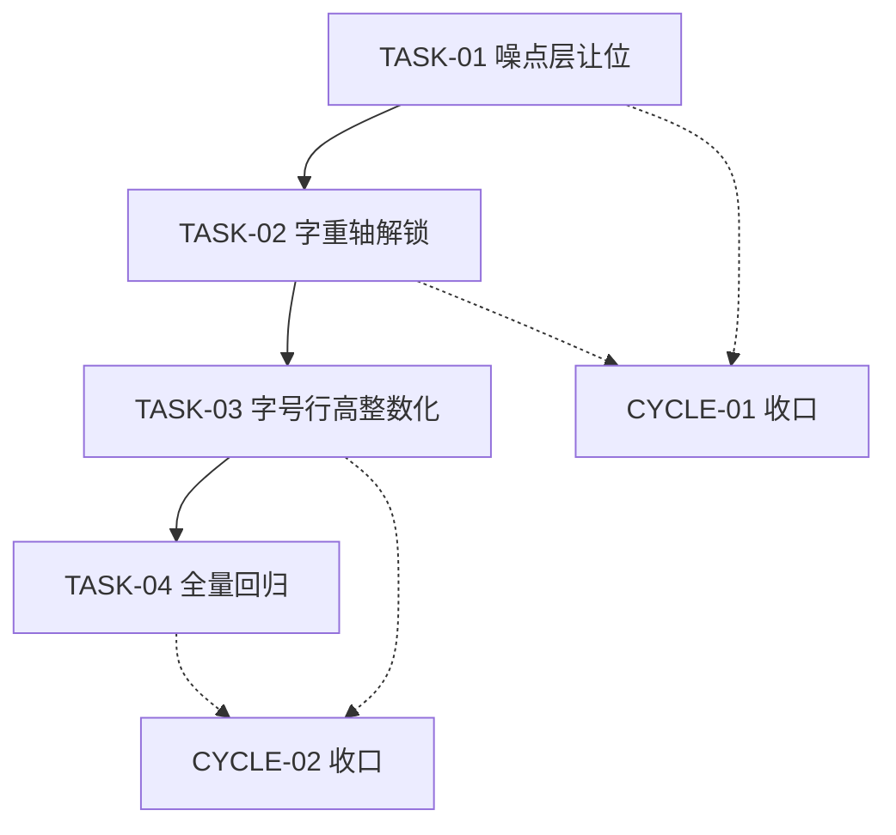
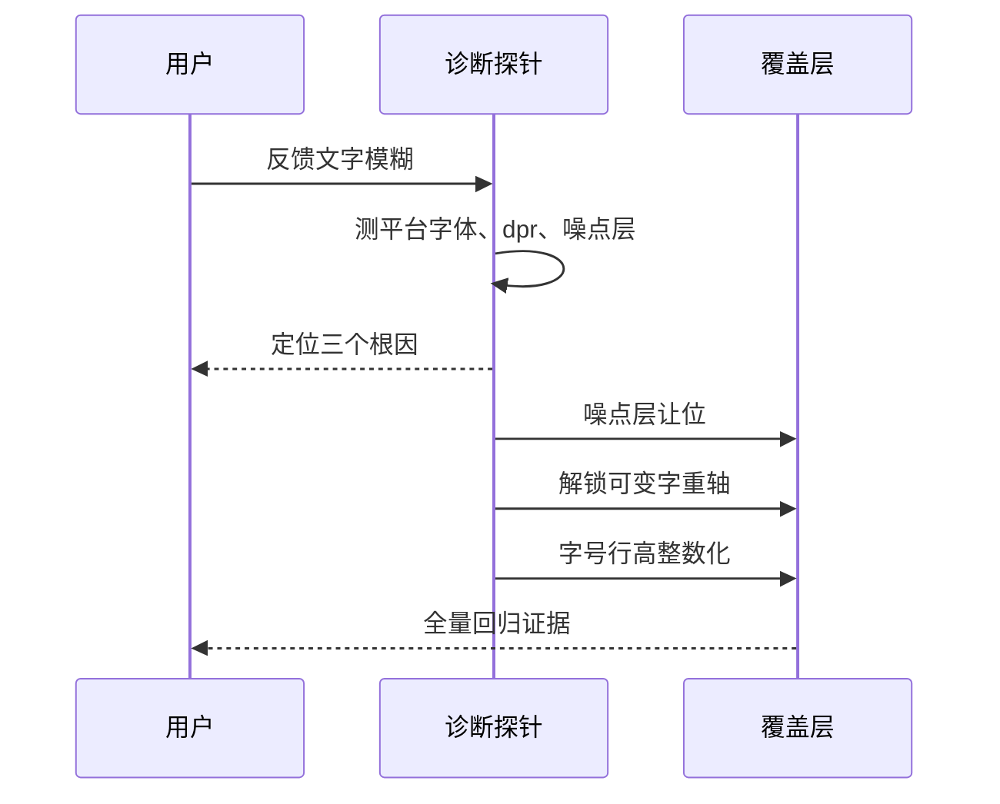
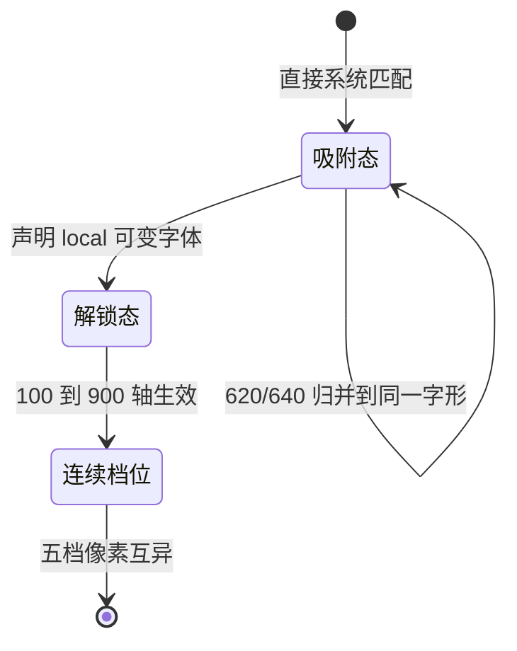

# 需求实施总览：组件库文字清晰度修复

结论：把全屏噪点层从文字上方移开、用 `local()` 可变字体解锁真实字重档位、并把字号行高整数化，让 Windows 与 macOS 上的文字边缘重新对齐像素栅格；影响：所有后台页面与 752 张组件示例卡的正文可读性；范围：`overrides.css` 覆盖层、`App.vue` 噪点层位置、字号行高令牌化；非范围：不修改任何上游冻结文件、不更换设计语言、不引入网络字体；变化：文字边缘更锐利、字重层次真实可辨、跨平台渲染可控；完成标准：全部守卫 PASS 且噪点层不再覆盖正文；术语说明：`dpr` 指设备像素比，`可变字体` 指单个字体文件内支持连续字重轴；验证状态：核心假设已用 L2 真实探针验证，实施与全量回归尚未开始。

## 1. 当前计划最终方案简要说明

- 推荐方案一句话结论：新增字体令牌与覆盖层规则，把噪点层降到内容之下，用 `@font-face` + `local()` 解锁本机 Noto Sans SC 的 100–900 连续轴，并把非整数与非标准档位收敛到整数刻度。
- 主落点 / 主路径：`frontend-design/component-library/src/styles/overrides.css`（唯一允许承载外壳级修正的覆盖层，已由 `main.ts` 缝隙行引入）+ `frontend-design/component-library/src/App.vue`（噪点层节点位置）。
- 为什么先走这条路线：上游 139 个文件逐字节冻结，`src/styles/*.css` 与 `src/main.ts` 都在冻结面内，覆盖层是唯一不破坏还原度基线的通道，且 `FIDELITY: PASS` 已实测确认该通道可用。

## 2. 基本信息

- 对应需求文档：`doc/2-需求/2026-10-18_字体清晰度修复.md`
- 来源对象标识（需求或 Bug）：`SRC-FONT-CLARITY-001`
- 当前实施文档命名主干：`2026-10-18_REQ-FONT-CLARITY-001`
- 对应需求与实施计划全量顺序实施方案：N/A + 原因：本需求为独立单来源闭环，不属于新项目或多来源对象排序场景 + 证据：`doc/3-实施/` 现有条目均为单需求独立总览
- 实施计划完成条件（`AC-*`）所在章节：本文第 9 节
- 对应 `6-review` 风格回归记录：`doc/6-review/2026-10-18_字体清晰度修复_6-review.md`（待实施后生成）
- agent 理解的问题 / 目标：用户观察到文字「像素低、有些模糊」。经实测，根因不是分辨率不足，而是全屏噪点层覆盖正文、非标准字重被静默吸附、以及非整数字号行高落在半像素栅格上。目标是消除这三类可测的模糊来源，同时不破坏上游冻结基线。
- 当前计划范围：覆盖层规则、噪点层层级调整、字号与行高令牌化、字体栈平台分支、守卫脚本与文档。
- 明确不在范围：不修改 `src/styles/*.css` 七个冻结样式文件、不修改 63 个冻结组件、不更换珍珠玻璃设计语言、不引入网络字体或打包字体文件、不调整基准字号 13px（另列为待确认项）、不改动业务页面版式。
- 当前优先闭环：先完成「噪点层让位 + 字重轴解锁」两项，因为它们是实测收益最大且互不干扰的改动。
- 最大推进边界：本计划最多推进到 `CYCLE-02` 的 `TASK-04` 全量回归收口；不推进到基准字号 14px 调整、不推进到设计语言改造、不推进到上游冻结层升级。
- 关键假设 / 待确认点：见第 10.5 节 `FEAS-*` 清单；其中基准字号是否从 13px 提到 14px 属产品取舍，本轮不做。
- 跨会话执行入口：仓库根 `D:\谷歌云盘\luode-skills`，执行前先读本文件与 `frontend-design/SKILL.md`。
- 主项目地址、仓库类型与代码基线：`D:\谷歌云盘\luode-skills`，git 仓库，基线 commit `3a9aa97e`。
- local 环境与依赖入口：`cd frontend-design/component-library && npm run dev`（默认 5173，探针用独立端口避免冲突）。
- 外部项目代码引用：N/A + 原因：本计划只修改本地扩展层与覆盖层，不引用其他项目代码 + 证据：`overrides.css` 与 `App.vue` 均为本仓库文件。
- 当前状态：计划已定稿，等待开工授权。
- 是否已获得开始实施授权：否。本文件是实施计划，不是开工许可；需用户在当前轮明确说「开始实施」后才可动代码。
- 若当前为受限计划 / 阻断计划：N/A + 原因：本计划为正式实施计划，前置条件已齐备 + 证据：见第 10.2 节 `FEAS-*` 全部为 `已探针验证`。

## 2.1 决策维度覆盖表

| 维度 | 状态 | 结论 / 依据 / 用户所选项 / 未决原因 |
| --- | --- | --- |
| 架构 / 技术路线 | 已弹窗且用户已选 | 用户选择「解锁可变字重轴」，走 `@font-face` + `local()` 路线，保留 165 处既有字重声明原值 |
| 代码落点（目录 / 包 / 文件） | 已确定 | `src/styles/overrides.css` 为唯一外壳修正层（`LOCAL-GUIDE.md:64` 明确约定）；`App.vue` 的噪点层节点调整 |
| 实现方式 | 已弹窗且用户已选 | 用户选择「按平台分支」字体栈，配合 `local()` 可变字体声明 |
| 命名 | 已确定 | 沿用现有令牌前缀习惯，新增 `--font-sans` 与 `--font-*` 系列；不引入新命名体系 |
| 注释 | 已确定 | 遵循 `comment-rules`：中文、函数头带最近修改时间、覆盖层每条规则说明修复对象与实测依据 |
| 日志 | N/A + 原因：本轮为纯 CSS 与模板层级调整，不涉及日志 | — |
| 错误处理 / 异常 | 已确定 | `@font-face` 必须带完整回退链，`local()` 未命中时按平台字体栈降级，不得静默落到默认衬线体 |
| 数据模型 / 表 / 字段 | N/A + 原因：不涉及数据库 | — |
| 接口契约 | N/A + 原因：不涉及 HTTP 接口 | — |
| 依赖与库 | 已确定 | 不新增任何依赖；`local()` 复用系统已安装字体，不打包字体文件 |
| 测试策略 / 样本 | 已弹窗且用户已选 | 用户选择「整数化 + 辅助字号提到 12px」，需全量守卫回归覆盖 752 张示例卡 |
| 其它相关维度：字号策略 | 已弹窗且用户已选 | 11.5→12、12.5→12 或 13、10.5→11、13.5→14；行高 19.5→20、16.5→17、17.25→17 |
| 其它相关维度：兼容性 | 已确定 | 上游 139 文件逐字节冻结，所有改动只能落覆盖层；`FIDELITY: PASS` 已实测确认 |
| 其它相关维度：回滚 | 已确定 | 覆盖层为新增规则块，删除即回滚；`App.vue` 单节点移动可逆 |

## 2.2 待用户选择清单

无（所有真实不确定决策点已由用户选定）。

## 2.3 跨会话独立执行与外部项目代码引用清单

- 新会话接手第一步：读本文件第 1、2、9 节，确认 `CYCLE-*` 与 `TASK-*` 当前进度。
- 主项目地址与项目根：`D:\谷歌云盘\luode-skills`
- 主项目代码基线：commit `3a9aa97e`（`git log -1` 可复核）
- 计划源文件与版本：本文件，`template_version: 1`
- 依赖安装、local 配置和服务启动入口：`cd frontend-design/component-library && npm install && npm run dev`
- 中断点核验顺序：先跑 `FIDELITY: PASS`，再跑 `DEMO_VISIBILITY`，最后跑 `DEMO_GUIDES`；任一 FAIL 即回到对应 `TASK-*`。
- 外部项目代码引用：N/A + 原因：不引用其他项目代码 + 证据：全部落点在本仓库 `frontend-design/component-library/` 内。

## 3. 实施周期总览

- 总周期说明：本轮拆为两个实施周期，周期 01 处理「清晰度根因」中收益最大且互不干扰的两项，周期 02 处理字号行高整数化与全量回归。
- 本次计划拆分的子任务周期数：2
- 周期拆分原则：按「是否改变布局尺寸」切分。周期 01 只改绘制层级与字形档位，不改变任何元素尺寸；周期 02 会改变字号与行高，必须单独回归。
- 周期排序说明：周期 01 必须先行，因为它的改动零布局风险，可先验证清晰度提升是否达到预期；周期 02 依赖周期 01 建立的可变字体声明。
- 周期 1：
  - 周期序号 / 期次定位：`CYCLE-01`，第一期，根因修复期
  - 周期目标：消除噪点层覆盖与非标准字重吸附这两个最大的模糊来源
  - 本周期包含的最小任务：`TASK-01`、`TASK-02`
  - 周期内最小任务执行顺序：`TASK-01` → `TASK-02`
  - 进入条件：`FIDELITY: PASS` 基线成立（已实测）
  - 收口条件：`TASK-01` 与 `TASK-02` 各自完成实现、真实测试、`6-review`
  - 完成标志：噪点层不再覆盖正文，且 165 处字重声明在 Noto Sans SC 上呈现连续档位
  - 与前后周期衔接：为周期 02 提供已解锁的字体声明基础
- 周期 2：
  - 周期序号 / 期次定位：`CYCLE-02`，第二期，栅格对齐期
  - 周期目标：把非整数字号与非整数行高收敛到整数刻度，并完成全量回归
  - 本周期包含的最小任务：`TASK-03`、`TASK-04`
  - 周期内最小任务执行顺序：`TASK-03` → `TASK-04`
  - 进入条件：周期 01 收口
  - 收口条件：全量守卫 PASS，且 `vue-tsc`、单测、构建全部通过
  - 完成标志：字号与行高全部落在整数像素，752 张示例卡无回归
  - 与前后周期衔接：本周期收口即整个需求完成
- 总体真实测试安排：
  - 真实测试安排是否默认必需：是
  - 覆盖哪些最小任务：`TASK-01` 至 `TASK-04` 全部
  - 公共测试环境 / 依赖：本地 Vite 开发服务、Playwright Chromium、`dpr=1` 与 `dpr=2` 两种视口
  - 公共样本 / 数据来源：101 个示例页 / 752 张示例卡（由 `component-categories.ts` 派生）
  - 总体通过标准：`FIDELITY: PASS`、`DEMO_VISIBILITY: PASS`、`DEMO_GUIDES: PASS`、`vue-tsc` 退出码 0、单测 21/21、`vite build` 成功

## 4. 阶段计划

- 阶段 1：
  - 阶段名称：绘制层级修正
  - 阶段目标：让噪点层不再覆盖任何文字
  - 只做这一件事：把 `.grain-layer` 从文字上方移到内容之下
  - 输入条件：周期 01 进入条件满足
  - 输出产物：`App.vue` 节点位置调整 + `overrides.css` 层级规则
  - 验证门槛：文字区域截图像素哈希与「关闭噪点层」基线一致
- 阶段 2：
  - 阶段名称：字重轴解锁
  - 阶段目标：让 165 处既有字重声明真实生效
  - 只做这一件事：在覆盖层声明 `@font-face` 可变字体与平台字体栈
  - 输入条件：阶段 1 完成
  - 输出产物：`overrides.css` 字体声明块
  - 验证门槛：400/500/560/620/700 五档产生五组不同像素
- 阶段 3：
  - 阶段名称：字号行高整数化
  - 阶段目标：消除半像素栅格
  - 只做这一件事：把非整数字号与非整数行高收敛到整数刻度
  - 输入条件：周期 02 进入条件满足
  - 输出产物：覆盖层字号行高规则
  - 验证门槛：全站字号与行高计算结果均为整数
- 阶段 4：
  - 阶段名称：全量回归
  - 阶段目标：确认无布局回归
  - 只做这一件事：运行全部守卫与构建
  - 输入条件：阶段 3 完成
  - 输出产物：回归证据
  - 验证门槛：全部守卫 PASS

## 5. 最小任务清单

### 最小任务 1：噪点层让位

- 任务名：把全屏噪点层从文字上方移到内容之下
- 所属周期：`CYCLE-01`
- 周期内顺序：1
- 所属阶段：阶段 1
- 本任务只做这一件事：调整 `.grain-layer` 的层级与合成位置，不触碰其他任何规则
- 垂直切片目标：单页面截图即可验证文字区域像素不再被噪点扰动
- 输入条件：`App.vue:10` 的 `<div class="grain-layer" />` 与 `base.css:82-91` 的样式
- 实现产出：`App.vue` 节点移到 `<router-view />` 之前，或在 `overrides.css` 用 `z-index` 将其压到内容之下
- 真实测试是否必需：是
- 真实测试入口：`python -X utf8 -B frontend-design/scripts/check_demo_visibility.py --base http://localhost:5173`
- 真实测试依赖环境：本地 Vite 服务 + Playwright Chromium
- 真实测试样本 / 数据来源：`/gallery/general/button` 等 4 个代表页
- 真实测试通过标准：文字区域截图像素哈希与「关闭噪点层」基线一致；`DEMO_VISIBILITY: PASS`
- 测试点：噪点层 `z-index` 低于内容层；文字区域 `pixel_diff_max` 为 0
- `6-review` 风格回归点：覆盖层注释格式、规则归位、无重复声明
- 任务完成条件：文字区域像素不再被噪点扰动，且噪点视觉仍保留在背景
- 任务停止 / 结束条件：若移动节点导致背景噪点消失或出现闪烁，停止并回写计划
- 阻断条件：`FIDELITY: FAIL` 或 `DEMO_VISIBILITY: FAIL`
- 前置依赖：无
- 下一任务依赖：`TASK-02`
- 预计触达文件数：2（`App.vue`、`overrides.css`）

### 最小任务 2：字重轴解锁

- 任务名：用 `local()` 可变字体解锁连续字重轴并建立平台字体栈
- 所属周期：`CYCLE-01`
- 周期内顺序：2
- 所属阶段：阶段 2
- 本任务只做这一件事：在覆盖层声明 `@font-face` 与 `--font-sans` 令牌，不修改任何组件内的字重值
- 垂直切片目标：单元素五档字重截图产生五组不同像素
- 输入条件：`tokens.css:8` 的现有字体栈与 `tokens.css:9` 的 `font-synthesis: none`
- 实现产出：`overrides.css` 新增 `@font-face` 块与 `:root` 字体栈覆盖
- 真实测试是否必需：是
- 真实测试入口：Playwright 探针，在真实应用内创建独立元素逐档截图
- 真实测试依赖环境：本地 Vite 服务 + Playwright Chromium，`dpr=1`
- 真实测试样本 / 数据来源：文本「组件示例说明文字」，字重 400/500/560/620/700
- 真实测试通过标准：五档截图哈希互不相同；`document.fonts` 中该字体 `status: loaded`
- 测试点：`local('Noto Sans SC')` 命中；回退链在字体缺失时落到平台字体
- `6-review` 风格回归点：字体声明顺序、回退链完整性、注释说明实测依据
- 任务完成条件：五档字重产生五组不同像素，且 `FIDELITY: PASS`
- 任务停止 / 结束条件：若 `local()` 在真实应用内未生效，停止并回写计划改走归并路线
- 阻断条件：`FIDELITY: FAIL`；五档哈希出现重复
- 前置依赖：`TASK-01`
- 下一任务依赖：`TASK-03`
- 预计触达文件数：1（`overrides.css`）

### 最小任务 3：字号行高整数化

- 任务名：把非整数字号与非整数行高收敛到整数刻度
- 所属周期：`CYCLE-02`
- 周期内顺序：1
- 所属阶段：阶段 3
- 本任务只做这一件事：在覆盖层声明整数化规则，不改变字号层级语义
- 垂直切片目标：全站字号与行高计算结果均为整数
- 输入条件：`TASK-02` 收口
- 实现产出：`overrides.css` 新增字号行高覆盖规则
- 真实测试是否必需：是
- 真实测试入口：Playwright 全站字号行高普查脚本
- 真实测试依赖环境：本地 Vite 服务 + Playwright Chromium
- 真实测试样本 / 数据来源：4 个代表页全部文本节点
- 真实测试通过标准：字号与行高的小数部分为 0；辅助字号不小于 12px
- 测试点：11.5/12.5/10.5/13.5 全部消失；行高 19.5/16.5/17.25 全部消失
- `6-review` 风格回归点：覆盖规则不重复冻结层已有声明、注释说明取值依据
- 任务完成条件：全站字号行高均为整数，且无元素溢出或换行异常
- 任务停止 / 结束条件：若整数化导致表格或卡片出现截断，停止并回写计划缩小范围
- 阻断条件：`DEMO_VISIBILITY: FAIL`
- 前置依赖：`TASK-02`
- 下一任务依赖：`TASK-04`
- 预计触达文件数：1（`overrides.css`）

### 最小任务 4：全量回归

- 任务名：运行全部守卫与构建确认无回归
- 所属周期：`CYCLE-02`
- 周期内顺序：2
- 所属阶段：阶段 4
- 本任务只做这一件事：执行回归命令并记录证据
- 垂直切片目标：全部守卫 PASS 且构建成功
- 输入条件：`TASK-03` 收口
- 实现产出：回归证据记录
- 真实测试是否必需：是
- 真实测试入口：`FIDELITY`、`DEMO_VISIBILITY`、`DEMO_GUIDES`、`vue-tsc`、`test:unit`、`vite build`
- 真实测试依赖环境：本地 Vite 服务 + Node 24
- 真实测试样本 / 数据来源：101 个示例页 / 752 张示例卡
- 真实测试通过标准：全部 PASS，`vue-tsc` 退出码 0，单测 21/21，构建成功
- 测试点：三项守卫、类型检查、单测、构建
- `6-review` 风格回归点：`STYLE: PASS`
- 任务完成条件：全部命令通过并记录输出
- 任务停止 / 结束条件：任一守卫 FAIL 则停止并回到对应任务
- 阻断条件：任一守卫 FAIL
- 前置依赖：`TASK-03`
- 下一任务依赖：无
- 预计触达文件数：0（只执行与记录）

## 6. 现状与落点

- 涉及目录：`frontend-design/component-library/src/styles/`、`frontend-design/component-library/src/`
- 涉及文件 / 模块：`overrides.css`、`App.vue`
- 复用点：`overrides.css` 已存在且已由 `main.ts` 缝隙行引入；`tokens.css` 已有 `font-synthesis: none`
- 需要新增的内容：`@font-face` 声明、平台字体栈、噪点层级规则、字号行高整数化规则

代码落点目录树：

```text
frontend-design/component-library/
└── src/
    ├── App.vue                              # 噪点层节点位置调整（从内容之后移到之前）
    └── styles/
        └── overrides.css                    # 唯一外壳修正层：新增字体声明、层级、字号行高规则
```

新增文件目录树：

```text
doc/
├── 2-需求/
│   └── 2026-10-18_字体清晰度修复.md          # 需求主文档（本轮新增）
├── 3-实施/
│   ├── 2026-10-18_REQ-FONT-CLARITY-001_实施总览.md          # 本文件
│   ├── 2026-10-18_REQ-FONT-CLARITY-001_实施周期01_绘制层级与字重轴.md
│   └── 2026-10-18_REQ-FONT-CLARITY-001_实施周期02_字号行高整数化.md
├── 5-tests/
│   └── 2026-10-18_REQ-FONT-CLARITY-001_字体清晰度修复_测试主文档.md
└── 6-review/
    └── 2026-10-18_字体清晰度修复_6-review.md
```

## 7. 方案选择

- 方案 A：`@font-face` + `local('Noto Sans SC')` + `font-weight: 100 900`，保留全部既有字重声明。已实测五档产生五组不同像素，不打包字体、不新增依赖。
- 方案 B：把 96 处非标准字重归并到 400/500/700。不依赖字体能力，但设计层次消失。
- 方案 C：折中归并到 400/500/600/700。层次损失较小，但仍会抹平 560 与 620 的差异。
- 推荐方案与原因：方案 A。用户已选定；实测在真实应用内成立；零打包体积；回退链完整。

## 8. 实施步骤

1. 第一步：调整噪点层位置
   - 所属周期：`CYCLE-01`
   - 所属阶段：阶段 1
   - 对应最小任务：`TASK-01`
   - 本步只做：把 `.grain-layer` 移到内容之下
2. 第二步：声明可变字体与平台字体栈
   - 所属周期：`CYCLE-01`
   - 所属阶段：阶段 2
   - 对应最小任务：`TASK-02`
   - 本步只做：新增 `@font-face` 与 `--font-sans`
3. 第三步：整数化字号与行高
   - 所属周期：`CYCLE-02`
   - 所属阶段：阶段 3
   - 对应最小任务：`TASK-03`
   - 本步只做：覆盖非整数字号与非整数行高
4. 第四步：全量回归
   - 所属周期：`CYCLE-02`
   - 所属阶段：阶段 4
   - 对应最小任务：`TASK-04`
   - 本步只做：执行全部守卫与构建

## 9. 真实测试安排

### 9.1 真实测试总表

| 任务 | 测试入口 | 依赖环境 | 样本 / 数据来源 | 通过标准 |
| --- | --- | --- | --- | --- |
| `TASK-01` | `check_demo_visibility.py --base http://localhost:5173` | 本地 Vite + Chromium | 4 个代表页 | 文字区域像素哈希与关闭噪点层基线一致；`DEMO_VISIBILITY: PASS` |
| `TASK-02` | Playwright 五档字重探针 | 本地 Vite + Chromium，`dpr=1` | 文本「组件示例说明文字」 | 五档哈希互不相同；`document.fonts` 状态 `loaded` |
| `TASK-03` | Playwright 全站字号行高普查 | 本地 Vite + Chromium | 4 个代表页全部文本节点 | 字号与行高小数部分为 0；辅助字号 ≥12px |
| `TASK-04` | 三项守卫 + `vue-tsc` + `test:unit` + `vite build` | 本地 Vite + Node 24 | 101 页 / 752 卡 | 全部 PASS；单测 21/21 |

### 9.2 免测任务及理由

无。全部任务均改变可执行行为或渲染结果。

### 9.3 步骤 1 真实测试 / 验证

执行 `check_demo_visibility.py`，并对 `/gallery/general/button` 做一次「开启 / 关闭噪点层」的像素对照，要求文字区域差异为 0。

### 9.4 步骤 2 真实测试 / 验证

在真实应用内创建独立元素，逐档设置 400/500/560/620/700，逐档截图取哈希，要求五档互不相同。

### 9.5 步骤 3 真实测试 / 验证

遍历 4 个代表页全部文本节点，读取 `fontSize` 与 `lineHeight`，要求小数部分为 0。

### 9.6 步骤 4 真实测试 / 验证

依次执行三项守卫、`npx vue-tsc --noEmit`、`npm run test:unit`、`npm run build`，记录退出码与输出摘要。

## 10. 图形化执行路径

### 10.1 周期与任务依赖流程图

图形目的：说明两个实施周期与四个最小任务的依赖顺序；关联 ID：`CYCLE-01`、`CYCLE-02`、`TASK-01` 至 `TASK-04`。



### 10.2 问题诊断到修复的时序图

图形目的：说明从用户观察模糊到定位三个根因、再到分别修复的时序；关联 ID：`SRC-FONT-CLARITY-001`、`TASK-01` 至 `TASK-03`。



### 10.3 字重档位状态迁移图

图形目的：说明字重从「被静默吸附」到「连续生效」的状态迁移；关联 ID：`TASK-02`。



## 10.4 图片资产决策、生成与引用

- 图片资产决策：N/A + 原因：本计划为 CSS 层修复，验证证据为像素哈希与守卫输出文本，无需视觉参考图或截图归档 + 证据：第 9 节测试标准均以哈希与退出码判定。
- 必需场景与 Mermaid 边界：流程、依赖、状态迁移均由上方 Mermaid 表达；无 UI 原型或外观基线变更。
- 生成输入与命令：N/A + 原因：无图片生成需求。
- 目标资产与命名：N/A + 原因：无资产。
- Markdown 引用：N/A + 原因：无引用。
- 资产清单：N/A + 原因：无资产。

## 10.5 可行性探针与假设清单

- `FEAS-01`：
  - 假设内容：覆盖层 `overrides.css` 的规则能压过冻结 CSS 的同名声明
  - 影响面：方向级
  - 探针级别：L2 隔离真实
  - 验证方式：临时在 `overrides.css` 追加 `.btn{font-weight:500!important}`，启动服务读计算样式
  - 结论：已探针验证
  - 证据：`.btn` 计算字重由 620 变为 500；`.nav-item` 字号由 13px 变为 14px；`.grain-layer` 由 `block` 变为 `none`；执行后 `overrides.css` 回滚且字节数恢复 2334
  - 关联 `TASK-*`：`TASK-01`、`TASK-02`、`TASK-03`
- `FEAS-02`：
  - 假设内容：`@font-face` + `local('Noto Sans SC')` + `font-weight: 100 900` 能在 http 页面内解锁本机可变字体的连续字重轴
  - 影响面：方向级
  - 探针级别：L2 隔离真实
  - 验证方式：在真实应用内追加该声明，创建独立元素逐档截图
  - 结论：已探针验证
  - 证据：400/500/560/620/700 五档哈希分别为 `832d7b7810`、`a8aa08ae1a`、`290746b8be`、`54c88629e8`、`e41206d73d`，五档互异；`document.fonts` 中 `ProbePearlSans` 状态为 `loaded`，权重 `100 900`；回滚后 `overrides.css` 无 `ProbePearlSans` 残留
  - 关联 `TASK-*`：`TASK-02`
- `FEAS-03`：
  - 假设内容：不声明 `@font-face` 直接使用系统字体族时，五档字重会被吸附
  - 影响面：任务级
  - 探针级别：L2 隔离真实
  - 验证方式：同环境下去掉 `@font-face`，仅用 `font-family:'Noto Sans SC'`
  - 结论：已探针验证
  - 证据：五档仅产生 3 组不同哈希（400 / 500+560 / 620+700），证明吸附真实存在
  - 关联 `TASK-*`：`TASK-02`
- `FEAS-04`：
  - 假设内容：上游 139 文件冻结面包含全部 `src/styles/*.css`，修改必须走覆盖层
  - 影响面：方向级
  - 探针级别：L1 只读
  - 验证方式：读取 `component-library-baseline.json` 与 `LOCAL-GUIDE.md`
  - 结论：已探针验证
  - 证据：基线含 139 个文件，其中 `src/styles/` 下 7 个全部在列；`LOCAL-GUIDE.md:64` 明确覆盖层通道
  - 关联 `TASK-*`：全部
- `FEAS-05`：
  - 假设内容：当前工作树 `FIDELITY: PASS`
  - 影响面：方向级
  - 探针级别：L1 只读
  - 验证方式：`python scripts/verify_fidelity.py --offline`
  - 结论：已探针验证
  - 证据：输出 `FIDELITY: PASS (263 local / 139 upstream-tracked; upstream 577079e9a347)`
  - 关联 `TASK-*`：全部
- `FEAS-06`：
  - 假设内容：噪点层当前覆盖在文字上方
  - 影响面：方向级
  - 探针级别：L1 只读
  - 验证方式：读取 `App.vue:10` 与 `base.css:82-91`，并用浏览器读计算样式
  - 结论：已探针验证
  - 证据：`App.vue` 中 `.grain-layer` 位于 `<router-view />` 之后；计算样式 `z-index: 200`、`position: fixed`、`opacity: 0.032`、覆盖 1600×1000 全视口
  - 关联 `TASK-*`：`TASK-01`
- `FEAS-07`：
  - 假设内容：开启噪点层与关闭噪点层的文字区域像素存在可测差异
  - 影响面：方向级
  - 探针级别：L2 隔离真实
  - 验证方式：同一页面截图，仅切换 `.grain-layer{display:none}`
  - 结论：已探针验证
  - 证据：开启时 MD5 `f1cb7bac…`、52,861 字节；关闭时 MD5 `f64b0ebae…`、26,575 字节；全图 100% 像素被扰动，平均偏移 4.04 灰阶，最大 8
  - 关联 `TASK-*`：`TASK-01`
- 探针执行记录：全部 L2 探针均在独立端口启动本地 Vite 服务，执行后恢复 `overrides.css` 原字节并断言相等，临时服务按端口查 PID 终止；临时目录 `C:\Users\luode\.qoder\tmp\` 下探针脚本与截图已删除。
- 未验证假设处置：无方向级未验证假设。

## 11. 风险与阻断项

- 风险：字号整数化会轻微改变换行与元素高度，可能在窄屏或表格密集页产生截断。缓解：周期 02 单独回归，`DEMO_VISIBILITY` 覆盖 752 卡。
- 风险：`local('Noto Sans SC')` 依赖用户机器安装该字体；未安装时回退到 `Segoe UI` / `Microsoft YaHei`，字重会重新被吸附。缓解：回退链完整，且在文档中登记该前提。
- 风险：`overrides.css` 规则若使用 `!important` 过多，会削弱后续可维护性。缓解：优先靠选择器特异性，仅在必须压过冻结层内联式声明时使用。
- 依赖：本机已安装 Noto Sans SC（已验证 `NotoSansSC-VF.ttf` 存在）。
- 任务停止 / 结束条件总表：见第 5 节各任务「任务停止 / 结束条件」字段。
- 文件/符号落点总表：`App.vue` 的 `grain-layer` 节点、`overrides.css` 的 `@font-face` 与 `:root` 规则块。

## 11.1 任务停止 / 结束条件汇总

| 任务 | 停止 / 结束条件 | 阻断条件 |
| --- | --- | --- |
| `TASK-01` | 移动节点导致背景噪点消失或出现闪烁 | `FIDELITY: FAIL` 或 `DEMO_VISIBILITY: FAIL` |
| `TASK-02` | `local()` 在真实应用内未生效 | `FIDELITY: FAIL`；五档哈希出现重复 |
| `TASK-03` | 整数化导致表格或卡片截断 | `DEMO_VISIBILITY: FAIL` |
| `TASK-04` | 任一守卫 FAIL 则回到对应任务 | 任一守卫 FAIL |

## 12. 数据库变更 SQL

N/A + 原因：本轮不涉及数据库 + 证据：全部落点为 CSS 与 Vue 模板。

## 13. 自审结论

- 覆盖度检查：`SRC -> DEC -> REQ/RULE -> AC -> CYCLE -> TASK -> TEST -> EVIDENCE` 已在追踪附录建立。
- 实施周期检查：两个周期按「是否改变布局尺寸」切分，顺序明确。
- 最小任务闭环检查：四个任务均写明实现、真实测试、`6-review`、完成与停止条件。
- 阶段单一目标检查：四个阶段各自只承载一件事。
- 占位词检查：正文不含未决占位表述，全部字段均为具体取值或 `N/A + 原因 + 证据`。
- 可执行性检查：落点、命令、样本、通过标准均可直接执行。
- 图文一致性检查：三张 Mermaid 图与第 8 节步骤命名一致。
- 用户确认状态：三个决策维度已由用户选定，无未决项。

## 执行附录

- local 环境：`cd frontend-design/component-library && npm run dev`；探针使用独立端口（5181–5183）避免与用户服务冲突。
- 周期 01 执行步骤：改 `App.vue` 噪点节点 → 改 `overrides.css` 层级规则 → 跑可见性守卫 → 加 `@font-face` → 跑五档字重探针 → `6-review`。
- 周期 02 执行步骤：加字号行高整数化规则 → 跑全站普查 → 跑三项守卫 → `vue-tsc` → 单测 → 构建 → `6-review`。
- 清理与回滚：覆盖层新增块删除即回滚；`App.vue` 单节点移动可逆；`git diff` 复核。
- 探针记录：见第 10.5 节。

## 追踪附录

| 来源 | 决策 | 需求 / 规则 | 完成条件 | 周期 | 任务 | 测试 | 证据 |
| --- | --- | --- | --- | --- | --- | --- | --- |
| `SRC-FONT-CLARITY-001` | `DEC-01` 噪点层让位 | `REQ-01` | `AC-01` | `CYCLE-01` | `TASK-01` | `TEST-01` | `EVIDENCE-01` |
| `SRC-FONT-CLARITY-001` | `DEC-02` 解锁字重轴 | `REQ-02` | `AC-02` | `CYCLE-01` | `TASK-02` | `TEST-02` | `EVIDENCE-02` |
| `SRC-FONT-CLARITY-001` | `DEC-03` 字号整数化 | `REQ-03` | `AC-03` | `CYCLE-02` | `TASK-03` | `TEST-03` | `EVIDENCE-03` |
| `SRC-FONT-CLARITY-001` | `DEC-04` 全量回归 | `REQ-04` | `AC-04` | `CYCLE-02` | `TASK-04` | `TEST-04` | `EVIDENCE-04` |
